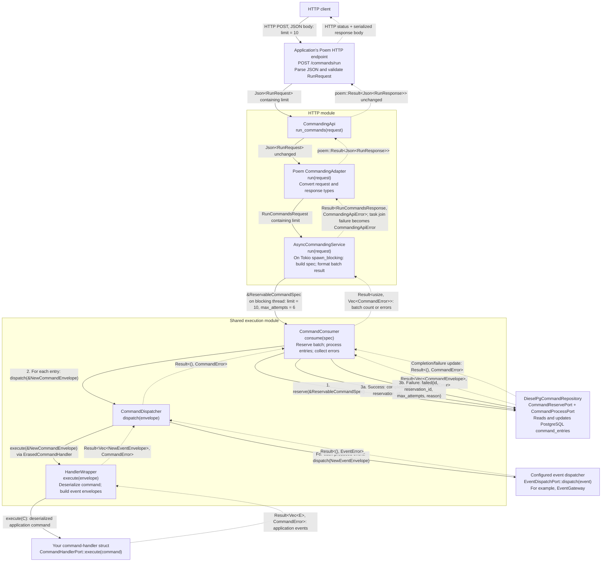

# mulac-commanding

## Module organization

- `src/execution/`: synchronous consumer, reservation specification, dispatcher,
  handler ports, and typed-handler wrapper. This is the diagrams' shared execution
  box, used by both HTTP APIs and application workers. Direct gateways reuse the
  dispatcher without batch consumption.
- `src/http/`: shared HTTP contracts and blocking-task bridge (`execution.rs`),
  plus Poem/Axum adapters. This is separate from synchronous shared execution.
- `src/application/`: envelopes, errors, storage ports, criteria, gateway,
  conversions, and reservation recovery.
- `src/domain/` and `src/infra_diesel/`: lifecycle policy and database implementation.

The execution module is private and exposes only a prelude internally. External
callers continue importing the same types through `mulac_commanding::prelude`;
this organization adds no runtime layer or feature requirement.

## Item failure isolation

Reservation is one transaction: malformed rows become `Failed`, and healthy
rows are returned without discarding the batch. Each consumer item contains
recoverable panics and attempts `Failed` on processing or completion errors,
then continues. Exhausted entries also stay `Failed`; the attempt cap still
prevents further automatic retries. No automatic path selects `Dead`.

Finalization still requires a working database/repository. Process termination,
abort-mode panics, and hung work require application-owned recovery; sweepers
must still be scheduled. See [the lifecycle and recovery contract](../../docs/item-failure-isolation.md)
for counts, diagnostics, retry timing, limitations, and PostgreSQL test commands.

## Two-phased command gateway dependency tree

`CommandGateway::two_phased` separates recording a command from executing it.
The gateway only records; the application must separately invoke the consumer.
This is deferred command processing, not a two-phase commit protocol.

The tree below shows constructor dependencies. The gateway and consumer must
use the same command store; they can share one repository through `Arc`.

```text
Phase 1: record
CommandGateway::two_phased(store)
└── Arc<dyn CommandStorePort>
    └── DieselPgCommandRepository (or a custom implementation)
        └── DbPool → PostgreSQL command_entries table

Phase 2: execute
CommandConsumer::new(repository, dispatcher)
├── Arc<R: CommandReservePort + CommandProcessPort>
│   └── Same command repository/store as phase 1
└── Arc<CommandDispatcher>
    ├── Arc<dyn ErasedCommandHandler>
    │   └── wrap_handler::<C, E>(handler)
    │       └── Arc<dyn CommandHandlerPort<C, E>>
    │           ├── C: DeserializeOwned + Send + Sync + 'static
    │           └── E: ApplicationEvent + 'static
    └── Arc<dyn EventDispatchPort>
        └── Application-supplied event dispatch implementation
            (for example, an EventGateway)

Reservation recovery (schedule separately)
CommandSweeper::new(port)
└── Arc<dyn CommandSweepPort>
    └── Same command repository/store
```

`wrap_handler` adapts one typed handler. For multiple command types, supply an
`ErasedCommandHandler` implementation that routes to the appropriate handlers
(the kernel supplies a command handler registry).

### Runtime inputs and responsibilities

1. Call `gateway.dispatch(NewCommandEnvelope { ... })` with metadata containing
   a caller-supplied `command_id`. Success means the command was recorded, not
   executed.
2. Call `consumer.consume(&ReservableCommandSpec::new(limit))` from an
   application-owned worker or explicit batch trigger. The consumer reserves
   due commands, executes their handlers, dispatches the resulting events, and
   marks successful commands completed. Dispatch failures are passed to the
   repository for failure recording and bounded retry handling.
3. Call `sweeper.sweep(&StaleCommandSpec::new(timeout))` to recover expired
   reservations. Keep the sweeper and consumer `max_attempts` settings aligned.

The supplied `DieselPgCommandRepository` implements all four storage ports and
requires the `diesel` feature, a database pool, and the command schema. Custom
repositories can implement the ports without Diesel. HTTP and Tokio features
are not required for this flow.

Import commanding types through `mulac_commanding::prelude` and event dispatch
types through `mulac_eventing::prelude`. Internal modules are private.

Two-phased command processing does not require two-phased event processing;
the supplied `EventDispatchPort` determines how events are handled. Handler
effects, event dispatch, and marking the command completed are separate calls,
not one atomic transaction. Design handlers and downstream processing to
tolerate retries.

## Poem: HTTP request through the structs and back

This diagram follows **one request** through the current implementation.
The application mounts `CommandingApi` under `/commands` in this example.
**Solid arrows are calls carrying the labeled input. Dotted arrows are returns
carrying the labeled output.** Calls below the consumer repeat for each reserved
command, and event dispatch repeats for each produced event.



### What changes at each boundary

| Struct                   | Receives                 | Passes onward                                                                   | Returns to its caller                                                               |
| ------------------------ | ------------------------ | ------------------------------------------------------------------------------- | ----------------------------------------------------------------------------------- |
| `CommandingApi`          | `Json<RunRequest>`       | Same request to adapter                                                         | `poem::Result<Json<RunResponse>>`                                                   |
| Poem `CommandingAdapter` | `Json<RunRequest>`       | Validated `RunCommandsRequest`                                                  | Converts validation error or service result to `Json<RunResponse>` or `poem::Error` |
| `AsyncCommandingService` | `RunCommandsRequest`     | `ReservableCommandSpec { limit, max_attempts: 6 }` to consumer on blocking pool | Converts consumer result to `RunCommandsResponse`, or returns task-join error       |
| `CommandConsumer`        | `&ReservableCommandSpec` | Reserved commands to dispatcher; lifecycle updates to repository                | `Ok(count)` or `Err(Vec<CommandError>)`                                             |
| `CommandDispatcher`      | `&NewCommandEnvelope`    | Command to handler; resulting event envelopes to event dispatcher               | `Ok(())` or `CommandError`                                                          |
| `HandlerWrapper`         | `&NewCommandEnvelope`    | Deserialized `C` to your handler                                                | Converts returned application events `E` into `NewEventEnvelope` values             |

`RunCommandsResponse` and the Poem `RunResponse` carry the same data:
`processed: Option<usize>` and `errors: Vec<String>`. The adapter changes their
Rust representation, not their meaning.

### What reaches the HTTP client

- **Batch succeeds:** HTTP 200 with, for example,
  `{ "processed": 3, "errors": [] }`. The count can be less than the limit.
- **Consumer returns errors:** HTTP 200 with
  `{ "processed": null, "errors": ["<error id>"] }`, one logged ID per failure. Other commands in that batch
  may already have succeeded; this is not a transaction rollback.
- **Invalid request:** Poem rejects invalid input before the endpoint method.
  The adapter also validates `limit` (`1..=1000`) when building
  `RunCommandsRequest`; its validation errors map to HTTP 400. No commands are
  consumed on validation failure. A bad `limit` keeps its message, and a body that
  can't be parsed returns only a logged error ID.
- **Blocking task fails to join:** the async service returns
  `CommandingApiError::RunTaskFailed`; the adapter maps it to HTTP 500 whose body is a logged error ID.

### Finding an error by ID

Error IDs are logged through `tracing` with the fields `error_id`, `queue` and `error`,
so search your logs for the ID. The host must install a `tracing` subscriber. Failures log
at `error` and unparsable bodies at `warn`. `EnvFilter::from_default_env()` shows only
`error` when `RUST_LOG` is unset, so set `RUST_LOG=warn` to see the IDs for unparsable bodies.

The diagram uses the standard `wrap_handler` path. When a kernel handler
registry is configured, the dispatcher's `ErasedCommandHandler::execute` call
first reaches `CommandHandlerRegistry`, which selects the wrapped handler by
`command_type`. A custom erased handler can implement a different execution path.
Likewise, the repository and event dispatcher are replaceable implementations
of their ports.

This endpoint processes commands already recorded in storage; it does not call
`CommandGateway` to submit new commands. The application constructs and supplies
the consumer and its dependencies; the HTTP service wrappers do not create them.
