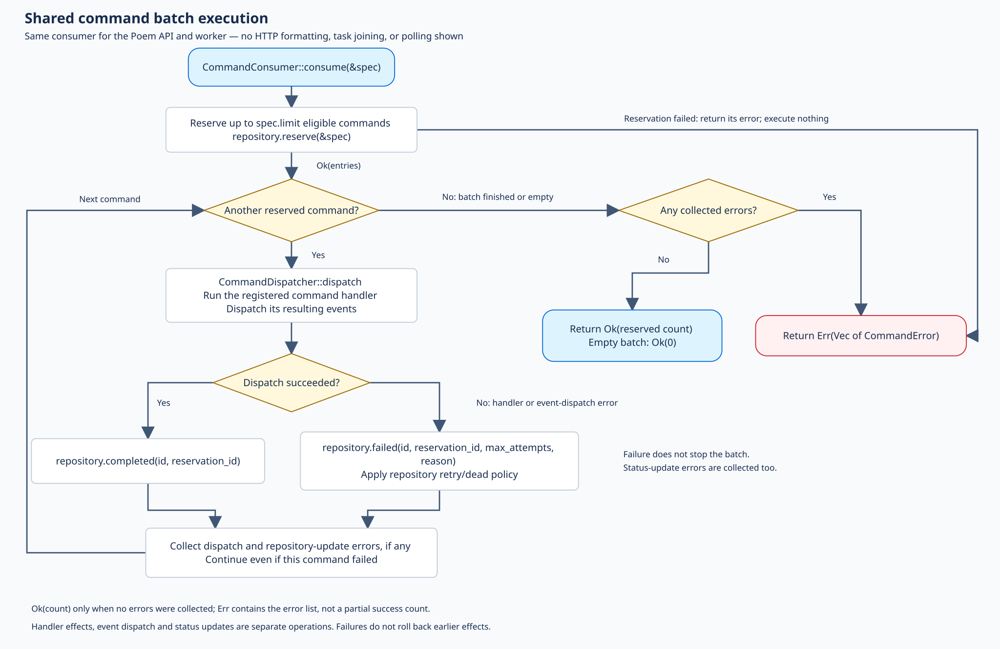
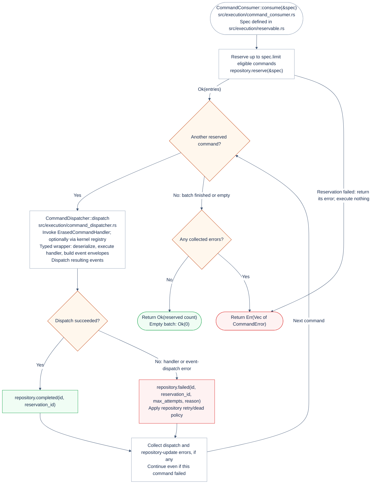
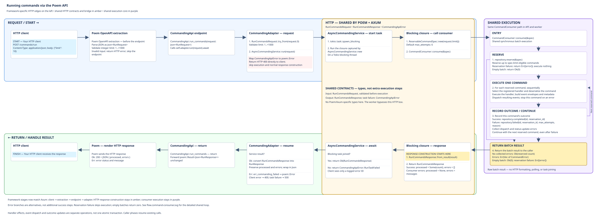
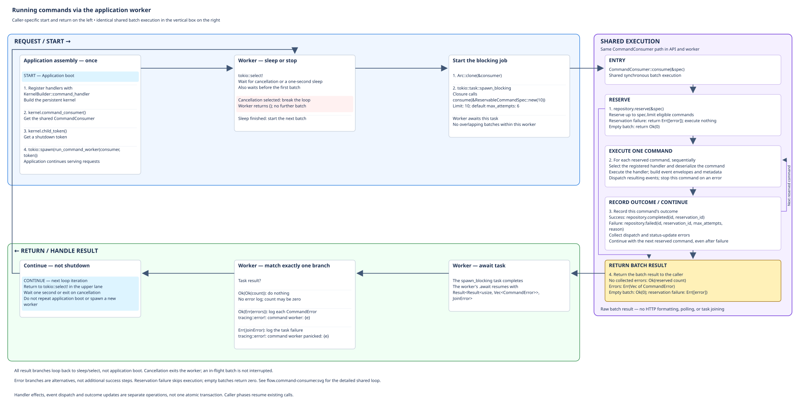
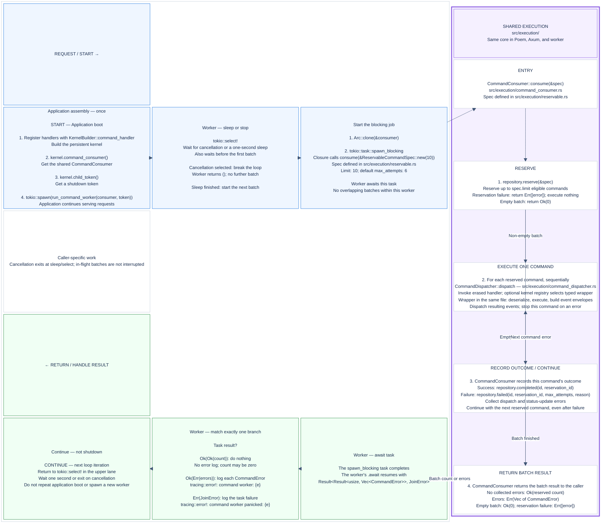
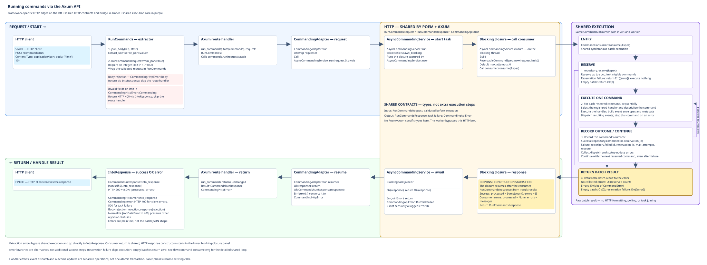

# Planning the Flow

The diagrams below display the **hand-arranged SVGs themselves**, preserving
exactly their colors, aligned request/return stages, and right-side shared
execution panels. Click a diagram to open the full-size SVG.

Editable Mermaid source is available below each image in an expandable section.
It describes the flow and current execution-file boundaries, but its automatic
layout is **not a pixel-exact reproduction** of the SVG. The caller sources
require a renderer with Mermaid `block-beta` support; the SVG previews do not.
Mermaid source and hand-arranged SVGs are maintained separately, not generated
from one another.

Panels group steps; error branches inside a panel are alternatives, not a
sequence. The highlighted lower HTTP panel marks where response construction
begins. The detailed batch loop shows its explicit decision branches.

### Shared command batch execution

The Poem API, Axum API, and application worker call this same execution core.
This diagram starts at `CommandConsumer::consume(&spec)` and ends when it
returns to its caller. HTTP validation/response formatting, blocking-task
management, and the worker's polling loop are deliberately outside this view.

The shared core lives in private `src/execution/` modules:
- `command_consumer.rs`: batch reservation, iteration, outcome recording, and return.
- `reservable.rs`: `ReservableCommandSpec`, its defaults, and eligibility criteria.
- `command_dispatcher.rs`: dispatcher, handler traits, and typed-handler wrapper,
  directly in the file rather than nested implementation modules.

These are source-file boundaries, not additional execution layers. Callers still
import through the crate prelude. The spec is input data, not a service or a
separate processing step. `src/http/execution.rs` remains the async HTTP bridge;
it is distinct from `src/execution/`. Storage implementations and the optional
kernel handler registry remain outside the execution module.

Editable Mermaid source (layout differs from SVG)

The commands in a reserved batch are processed **sequentially**. A command
failure does not stop the rest of the batch. Failure to update a command's
completion/failure status is also collected as an error. A reservation failure
returns immediately, without executing commands.

`Ok(count)` is returned only when there are no collected errors; otherwise the
consumer returns the error list, not a partial success count. Handler effects,
event dispatch, and outcome updates are separate operations, not one atomic
transaction; failures do not roll back earlier effects.

Hand-arranged SVG export: [flow.command-consumer.svg](flow.command-consumer.svg).

### Running commands via the Poem API

```mermaid
---
config:
  theme: base
  themeVariables:
    darkMode: false
    background: '#ffffff'
    primaryColor: '#ffffff'
    secondaryColor: '#eff6ff'
    tertiaryColor: '#f5f0ff'
    primaryTextColor: '#172b4d'
    secondaryTextColor: '#172b4d'
    tertiaryTextColor: '#172b4d'
    textColor: '#172b4d'
    nodeTextColor: '#172b4d'
    titleColor: '#172b4d'
    lineColor: '#405675'
    edgeLabelBackground: '#ffffff'
---
block-beta
    columns 7
    block:poem_framework:4
        columns 4
        poem_request_title["REQUEST / START →"]:4
        poem_request_0["HTTP client<br/><br/>START — Your HTTP client<br/>POST /commands/run<br/>Content-Type: application/json; body: {&quot;limit&quot;: 10}"]
        poem_request_1["Poem OpenAPI extraction<br/><br/>Poem OpenAPI extraction — before the endpoint<br/>Parse JSON as Json&lt;RunRequest&gt;<br/>Validate integer limit: 1..=1000<br/>Invalid input: return HTTP error; skip the endpoint"]
        poem_request_2["CommandingApi endpoint<br/><br/>CommandingApi::run_commands(request: Json&lt;RunRequest&gt;)<br/>Calls self.adapter.run(request).await"]
        poem_request_3["CommandingAdapter — request<br/><br/>1. RunCommandsRequest::try_from(request.0)<br/>Validate limit: 1..=1000<br/><br/>2. AsyncCommandingService::run(request)<br/><br/>Invalid request: map CommandingApiError to poem::Error<br/>Return HTTP 400 directly to client;<br/>skip execution and normal response construction"]
        poem_edge_note["Framework-specific edge<br/>Validation errors skip shared execution and return directly to the client"]:4
        poem_response_title["← RETURN / HANDLE RESULT"]:4
        poem_response_0["HTTP client<br/><br/>FINISH — Your HTTP client receives the response"]
        poem_response_1["Poem — render HTTP response<br/><br/>Poem sends the HTTP response<br/>Ok: 200 + JSON { processed, errors }<br/>Err: error status and message"]
        poem_response_2["CommandingApi — return<br/><br/>CommandingApi::run_commands — return<br/>Forward poem::Result&lt;Json&lt;RunResponse&gt;&gt; unchanged"]
        poem_response_3["CommandingAdapter — resume<br/><br/>Service result?<br/><br/>Ok: convert RunCommandsResponse into RunResponse<br/>Preserve processed and errors; wrap in Json<br/><br/>Err: err_commanding_failed → poem::Error<br/>Client error → 400; task failure → 500"]
    end
    block:poem_http:2
        columns 2
        poem_http_title["HTTP — SHARED BY POEM + AXUM<br/>Async bridge: src/http/execution.rs"]:2
        poem_http_request_0["AsyncCommandingService — start task<br/><br/>1. tokio::task::spawn_blocking<br/><br/>2. Run the closure captured by AsyncCommandingService::new<br/>On a Tokio blocking thread"]
        poem_http_request_1["Blocking closure — call consumer<br/><br/>1. ReservableCommandSpec::new(request.limit())<br/>Type defined in src/execution/reservable.rs<br/>Default max_attempts: 6<br/><br/>2. CommandConsumer::consume(&amp;spec)"]
        poem_contracts["SHARED CONTRACTS — types, not execution steps<br/>RunCommandsRequest / RunCommandsResponse / CommandingApiError<br/>The worker bypasses this HTTP box"]:2
        poem_http_response_0["AsyncCommandingService — await<br/><br/>Blocking task joined?<br/><br/>Yes: return Ok(RunCommandsResponse)<br/><br/>No: return CommandingApiError::RunTaskFailed<br/>Client sees only a logged error ID"]
        poem_http_response_1["Blocking closure — response<br/><br/>RESPONSE CONSTRUCTION STARTS HERE<br/>1. RunCommandsResponse::from_result(result)<br/><br/>2. Return RunCommandsResponse<br/>Success: processed = Some(count), errors = []<br/>Consumer errors: processed = None, errors = messages"]
    end
    block:poem_shared
        columns 1
        poem_core_title["SHARED EXECUTION<br/>src/execution/<br/>Same core in Poem, Axum, and worker"]
        poem_core_consume["ENTRY<br/><br/>CommandConsumer::consume(&amp;spec)<br/>src/execution/command_consumer.rs<br/>Spec defined in src/execution/reservable.rs"]
        space
        poem_core_reserve["RESERVE<br/><br/>1. repository.reserve(&amp;spec)<br/>Reserve up to spec.limit eligible commands<br/>Reservation failure: return Err([error]); execute nothing<br/>Empty batch: return Ok(0)"]
        space
        poem_core_execute["EXECUTE ONE COMMAND<br/><br/>2. For each reserved command, sequentially<br/>CommandDispatcher::dispatch — src/execution/command_dispatcher.rs<br/>Invoke erased handler; optional kernel registry selects typed wrapper<br/>Wrapper in the same file: deserialize, execute, build event envelopes<br/>Dispatch resulting events; stop this command on an error"]
        space
        poem_core_outcome["RECORD OUTCOME / CONTINUE<br/><br/>3. CommandConsumer records this command's outcome<br/>Success: repository.completed(id, reservation_id)<br/>Failure: repository.failed(id, reservation_id, max_attempts, reason)<br/>Collect dispatch and status-update errors<br/>Continue with the next reserved command, even after failure"]
        space
        poem_core_return["RETURN BATCH RESULT<br/><br/>4. CommandConsumer returns the batch result to the caller<br/>No collected errors: Ok(reserved count)<br/>Errors: Err(Vec of CommandError)<br/>Empty batch: Ok(0); reservation failure: Err([error])"]
    end

    %% Fixed columns align each request stage with its return stage.
    poem_request_0 --> poem_request_1
    poem_request_1 --> poem_request_2
    poem_request_2 --> poem_request_3
    poem_request_3 -- "Validated RunCommandsRequest" --> poem_http_request_0
    poem_http_request_0 --> poem_http_request_1
    poem_http_request_1 --> poem_core_consume
    poem_http_response_1 --> poem_http_response_0
    poem_http_response_0 -- "Response or task error" --> poem_response_3
    poem_response_3 --> poem_response_2
    poem_response_2 --> poem_response_1
    poem_response_1 --> poem_response_0
    poem_core_return -- "Batch count or errors" --> poem_http_response_1
    poem_core_consume --> poem_core_reserve
    poem_core_reserve -- "Non-empty batch" --> poem_core_execute
    poem_core_reserve -- "Empty or reservation error" --> poem_core_return
    poem_core_execute --> poem_core_outcome
    poem_core_outcome -- "Next command" --> poem_core_execute
    poem_core_outcome -- "Batch finished" --> poem_core_return
    classDef request fill:#eff6ff,stroke:#0969da,color:#172b4d
    classDef response fill:#f0fff4,stroke:#1a7f37,color:#172b4d
    classDef neutral fill:#ffffff,stroke:#c1cbd8,color:#172b4d
    classDef highlight fill:#fff1b8,stroke:#bf8700,color:#172b4d
    class poem_request_0,poem_request_1,poem_request_2,poem_request_3,poem_request_title request
    class poem_response_0,poem_response_1,poem_response_2,poem_response_3,poem_response_title response
    class poem_edge_note neutral
    style poem_framework fill:#ffffff,stroke:#c1cbd8,color:#172b4d
    style poem_shared fill:#f5f0ff,stroke:#8250df,stroke-width:3px,color:#172b4d
    style poem_core_title fill:#f5f0ff,stroke:#8250df,color:#172b4d
    style poem_http fill:#fff8e8,stroke:#bf8700,stroke-width:3px,color:#172b4d
    style poem_http_title fill:#fff8e8,stroke:#bf8700,color:#172b4d
    style poem_contracts fill:#fff8e8,stroke:#bf8700,color:#172b4d
    class poem_http_request_0,poem_http_request_1,poem_http_response_0 neutral
    class poem_http_response_1 highlight
    class poem_core_consume neutral
    class poem_core_reserve neutral
    class poem_core_execute neutral
    class poem_core_outcome neutral
    class poem_core_return neutral
```

Editable Mermaid source (layout differs from SVG)

The framework edge uses the same presentation granularity as Axum: **client →
extraction → endpoint → adapter**. Poem OpenAPI performs extraction before
`CommandingApi::run_commands`; Axum uses its explicit `RunCommands` extractor.
Poem then converts the wire request into `RunCommandsRequest` in its adapter;
Axum already constructs that validated contract in its extractor. The boxes
represent comparable stages, not identical framework implementations.

The **HTTP — shared by Poem and Axum** box groups the common request/response
contracts and `AsyncCommandingService`: blocking-task execution, specification
construction, response formatting, and task-failure sanitization. The framework
extractors/adapters, schema wrappers, HTTP status mapping, and response rendering
remain outside this shared box. The purple execution box is a separate shared
core used by **both APIs and the worker**; the worker bypasses the shared HTTP
box. These boxes mark existing responsibilities, not new runtime layers.

Read the **upper caller lane left to right**, enter the **vertical shared
execution box on the right**, then follow the **lower return lane right to
left**, finishing at the client. The shared box is the same batch-processing
path used by the application worker; its return step ends the consumer call.
Numbered actions within each phase read **top to bottom**. Phases labeled
**resume** or **return** continue the existing call; they do not invoke it again.
Arrow labels identify passed or returned values.

The turn into the normal response path is **after `CommandConsumer::consume`
returns**. The highlighted `RunCommandsResponse::from_result(result)` in the
`AsyncCommandingService` closure is where the response body is first constructed,
still on the blocking thread. It is then returned through the async service, converted
to Poem's `Json<RunResponse>` by the adapter, and sent by Poem. Inner handler and
dispatcher returns are still batch execution, not HTTP response construction.

Early validation errors bypass this normal path and return directly to the
client. A blocking-task join failure instead enters the lower lane at
`AsyncCommandingService::run`'s error branch; it need not have passed response
construction. Error branches stop their path rather than continuing into
success-only steps.

Hand-arranged SVG export: [flow-poem-api.svg](flow-poem-api.svg).

`/commands` is an example mount prefix; the declared route is `POST /run`.
Poem rejects invalid input before the endpoint method, and the adapter also
validates conversion into `RunCommandsRequest`. Early HTTP errors return to the
client without entering the consumer.

The shared box summarizes the [detailed batch execution flow](#shared-command-batch-execution).
Its execution/outcome steps repeat for each reserved command. With Diesel,
reservation atomically marks commands reserved and increments their attempt
counts. Completion/failure updates use `CommandProcessPort` on the same
repository. A reservation failure skips the entire execution loop; an empty
batch executes no handlers and returns zero.

Within shared execution, `wrap_handler` performs typed conversion and metadata
construction, and the optional kernel registry selects the handler. A custom
`ErasedCommandHandler` may implement a different path. Handler effects, event
dispatch, and command outcome updates are separate operations, not one atomic
transaction. A command failure does not undo successful commands in the batch.

Consumer errors are reported inside an **HTTP 200** batch response:
`{ "processed": null, "errors": ["..."] }`. They are distinct from validation
errors (HTTP 400) and blocking-task join failures (HTTP 500). An async task failure
can interrupt the normal return journey; the join-error branch represents that
alternative, not an extra step after successful consumption.

### Running commands via the application worker

Editable Mermaid source (layout differs from SVG)

Read the **upper boot/work lane left to right**, enter the **vertical shared
execution box on the right**, then follow the **lower return lane right to
left**. The shared box matches the Poem diagram; only the caller-specific start
and result handling differ. The return boundary is where `CommandConsumer::consume`
finishes and returns its batch result. The blocking task completes, the worker's
`.await` resumes, and the worker matches the result. A task failure can skip the
normal consumer return and resume `.await` with `Err(JoinError)` instead.

The lower lane ends at **continue**, not application shutdown: all result
branches return to the upper lane's **sleep/cancellation select**, without
repeating boot or spawning another worker. There is no HTTP response and no
`RunCommandsResponse` construction. The worker itself returns `()` only when
cancellation is selected and its loop exits.

Hand-arranged SVG export: [flow.command-worker.svg](flow.command-worker.svg).

The application registers **command handlers** during assembly, then starts one
long-running worker task at boot. It does not enqueue a special recurring
command. The worker invokes `CommandConsumer` directly; it does not go through
HTTP, `RunCommandsRequest`, or `AsyncCommandingService`.

Each iteration processes **up to ten eligible commands**, waits **one second
after the batch finishes**, then tries again. Empty batches and failed batches
also sleep before retrying. This is a delay between batches, not a fixed
one-second start-to-start schedule. The existing implementation in
`kernel/src/workers.rs` also sleeps before the first batch.

Reservation eligibility and retry limits still apply: sleeping does not make a
failed command immediately eligible. The consumer uses the same handler, event
dispatch, and completion/failure path described above, including its non-atomic
side effects. There is no HTTP response; the worker logs consumer or task errors
and continues polling.

`kernel.shutdown()` cancels the child token. Cancellation is observed at the
sleep/select step; it does not interrupt an in-flight blocking batch. If the
application must drain that batch before exiting, it must retain and await the
worker's `JoinHandle`; `PersistentKernelHandle::wait()` does not join separately
spawned workers.

### Running commands via the Axum API

```mermaid
---
config:
  theme: base
  themeVariables:
    darkMode: false
    background: '#ffffff'
    primaryColor: '#ffffff'
    secondaryColor: '#eff6ff'
    tertiaryColor: '#f5f0ff'
    primaryTextColor: '#172b4d'
    secondaryTextColor: '#172b4d'
    tertiaryTextColor: '#172b4d'
    textColor: '#172b4d'
    nodeTextColor: '#172b4d'
    titleColor: '#172b4d'
    lineColor: '#405675'
    edgeLabelBackground: '#ffffff'
---
block-beta
    columns 7
    block:axum_framework:4
        columns 4
        axum_request_title["REQUEST / START →"]:4
        axum_request_0["HTTP client<br/><br/>START — HTTP client<br/>POST /commands/run<br/>Content-Type: application/json; body: {&quot;limit&quot;: 10}"]
        axum_request_1["RunCommands — extractor<br/><br/>1. json_body(req, state)<br/>Extract Json&lt;serde_json::Value&gt;<br/><br/>2. RunCommandsRequest::from_json(value)<br/>Require an integer limit in 1..=1000<br/>Wrap the validated request in RunCommands<br/><br/>Body rejection → CommandingHttpError::Body<br/>Return via IntoResponse; skip the route handler<br/><br/>Invalid fields or limit → CommandingHttpError::Commanding<br/>Return HTTP 400 via IntoResponse; skip the route handler"]
        axum_request_2["Axum route handler<br/><br/>run_commands(State(commands), request: RunCommands)<br/>Calls commands.run(request).await"]
        axum_request_3["CommandingAdapter — request<br/><br/>CommandingAdapter::run<br/>Unwrap request.0<br/>Call AsyncCommandingService::run(request.0).await"]
        axum_edge_note["Framework-specific edge<br/>Validation errors skip shared execution and return directly to the client"]:4
        axum_response_title["← RETURN / HANDLE RESULT"]:4
        axum_response_0["HTTP client<br/><br/>FINISH — HTTP client receives the response"]
        axum_response_1["IntoResponse — success OR error<br/><br/>CommandsRunResponse::into_response<br/>Json(self.0).into_response()<br/>HTTP 200 + JSON {processed, errors}<br/><br/>CommandingHttpError::into_response<br/>Commanding error: HTTP 400 for client errors, 500 for task failure<br/>Body rejection: rejection_response(rejection)<br/>Normalize JsonDataError to 400; preserve other rejection statuses<br/>Errors are plain text, not the batch JSON shape"]
        axum_response_2["Axum route handler — return<br/><br/>run_commands returns unchanged<br/>Result&lt;CommandsRunResponse, CommandingHttpError&gt;"]
        axum_response_3["CommandingAdapter — resume<br/><br/>CommandingAdapter::run resumes<br/>Ok(response): return Ok(CommandsRunResponse(response))<br/>Err(error): ? converts it to CommandingHttpError"]
    end
    block:axum_http:2
        columns 2
        axum_http_title["HTTP — SHARED BY POEM + AXUM<br/>Async bridge: src/http/execution.rs"]:2
        axum_http_request_0["AsyncCommandingService — start task<br/><br/>AsyncCommandingService::run<br/>tokio::task::spawn_blocking<br/>Runs the closure captured by AsyncCommandingService::new"]
        axum_http_request_1["Blocking closure — call consumer<br/><br/>AsyncCommandingService closure — on the blocking thread<br/>Build ReservableCommandSpec::new(request.limit())<br/>Type defined in src/execution/reservable.rs<br/>Default max_attempts: 6<br/>Call consumer.consume(&amp;spec)"]
        axum_contracts["SHARED CONTRACTS — types, not execution steps<br/>RunCommandsRequest / RunCommandsResponse / CommandingApiError<br/>The worker bypasses this HTTP box"]:2
        axum_http_response_0["AsyncCommandingService — await<br/><br/>Blocking task joined?<br/><br/>Ok(response): return Ok(response)<br/><br/>Err(JoinError): return CommandingApiError::RunTaskFailed<br/>Client sees only a logged error ID"]
        axum_http_response_1["Blocking closure — response<br/><br/>RESPONSE CONSTRUCTION STARTS HERE<br/>The closure resumes after the consumer<br/>RunCommandsResponse::from_result(result)<br/>Success: processed = Some(count), errors = []<br/>Consumer errors: processed = None, errors = messages<br/>Return RunCommandsResponse"]
    end
    block:axum_shared
        columns 1
        axum_core_title["SHARED EXECUTION<br/>src/execution/<br/>Same core in Poem, Axum, and worker"]
        axum_core_consume["ENTRY<br/><br/>CommandConsumer::consume(&amp;spec)<br/>src/execution/command_consumer.rs<br/>Spec defined in src/execution/reservable.rs"]
        space
        axum_core_reserve["RESERVE<br/><br/>1. repository.reserve(&amp;spec)<br/>Reserve up to spec.limit eligible commands<br/>Reservation failure: return Err([error]); execute nothing<br/>Empty batch: return Ok(0)"]
        space
        axum_core_execute["EXECUTE ONE COMMAND<br/><br/>2. For each reserved command, sequentially<br/>CommandDispatcher::dispatch — src/execution/command_dispatcher.rs<br/>Invoke erased handler; optional kernel registry selects typed wrapper<br/>Wrapper in the same file: deserialize, execute, build event envelopes<br/>Dispatch resulting events; stop this command on an error"]
        space
        axum_core_outcome["RECORD OUTCOME / CONTINUE<br/><br/>3. CommandConsumer records this command's outcome<br/>Success: repository.completed(id, reservation_id)<br/>Failure: repository.failed(id, reservation_id, max_attempts, reason)<br/>Collect dispatch and status-update errors<br/>Continue with the next reserved command, even after failure"]
        space
        axum_core_return["RETURN BATCH RESULT<br/><br/>4. CommandConsumer returns the batch result to the caller<br/>No collected errors: Ok(reserved count)<br/>Errors: Err(Vec of CommandError)<br/>Empty batch: Ok(0); reservation failure: Err([error])"]
    end

    %% Fixed columns align each request stage with its return stage.
    axum_request_0 --> axum_request_1
    axum_request_1 --> axum_request_2
    axum_request_2 --> axum_request_3
    axum_request_3 -- "Validated RunCommandsRequest" --> axum_http_request_0
    axum_http_request_0 --> axum_http_request_1
    axum_http_request_1 --> axum_core_consume
    axum_http_response_1 --> axum_http_response_0
    axum_http_response_0 -- "Response or task error" --> axum_response_3
    axum_response_3 --> axum_response_2
    axum_response_2 --> axum_response_1
    axum_response_1 --> axum_response_0
    axum_core_return -- "Batch count or errors" --> axum_http_response_1
    axum_core_consume --> axum_core_reserve
    axum_core_reserve -- "Non-empty batch" --> axum_core_execute
    axum_core_reserve -- "Empty or reservation error" --> axum_core_return
    axum_core_execute --> axum_core_outcome
    axum_core_outcome -- "Next command" --> axum_core_execute
    axum_core_outcome -- "Batch finished" --> axum_core_return
    classDef request fill:#eff6ff,stroke:#0969da,color:#172b4d
    classDef response fill:#f0fff4,stroke:#1a7f37,color:#172b4d
    classDef neutral fill:#ffffff,stroke:#c1cbd8,color:#172b4d
    classDef highlight fill:#fff1b8,stroke:#bf8700,color:#172b4d
    class axum_request_0,axum_request_1,axum_request_2,axum_request_3,axum_request_title request
    class axum_response_0,axum_response_1,axum_response_2,axum_response_3,axum_response_title response
    class axum_edge_note neutral
    style axum_framework fill:#ffffff,stroke:#c1cbd8,color:#172b4d
    style axum_shared fill:#f5f0ff,stroke:#8250df,stroke-width:3px,color:#172b4d
    style axum_core_title fill:#f5f0ff,stroke:#8250df,color:#172b4d
    style axum_http fill:#fff8e8,stroke:#bf8700,stroke-width:3px,color:#172b4d
    style axum_http_title fill:#fff8e8,stroke:#bf8700,color:#172b4d
    style axum_contracts fill:#fff8e8,stroke:#bf8700,color:#172b4d
    class axum_http_request_0,axum_http_request_1,axum_http_response_0 neutral
    class axum_http_response_1 highlight
    class axum_core_consume neutral
    class axum_core_reserve neutral
    class axum_core_execute neutral
    class axum_core_outcome neutral
    class axum_core_return neutral
```

Editable Mermaid source (layout differs from SVG)

The **HTTP — shared by Poem and Axum** box groups the common request/response
contracts and `AsyncCommandingService`: blocking-task execution, specification
construction, response formatting, and task-failure sanitization. The framework
extractors/adapters, schema wrappers, HTTP status mapping, and response rendering
remain outside this shared box. The purple execution box is a separate shared
core used by **both APIs and the worker**; the worker bypasses the shared HTTP
box. These boxes mark existing responsibilities, not new runtime layers.

Read the **upper caller lane left to right**, enter the **vertical shared
execution box on the right**, then follow the **lower return lane right to
left**. The shared box matches the Poem and worker diagrams. Response
construction remains outside it and starts at
`RunCommandsResponse::from_result`, after the consumer returns, just as in the
Poem flow. The consumer box expands into the
[shared command batch execution diagram](#shared-command-batch-execution).

`command_routes(service)` declares `POST /run` and installs `CommandingAdapter`
as router state. `/commands` is an example application-owned mount prefix.
The host supplies authentication, authorization, and other middleware; this
endpoint processes queued commands rather than submitting new commands.

Axum's `RunCommands` extractor reads and validates the body **before invoking
`run_commands`**. Extraction failures bypass the service and consumer and go
directly to `CommandingHttpError::into_response` in the return lane. Invalid
fields or limits return HTTP 400. Body rejections preserve Axum's status (for
example, unsupported content type or a body exceeding the configured limit),
except `JsonDataError`, which is normalized to 400.

Once consumption starts, this is the same shared service and consumer path as
Poem. Consumer errors, including reservation failures, become an **HTTP 200**
batch response with `processed: null` and one logged error ID per failure. An empty successful
batch returns `processed: 0`. A blocking-task join failure can bypass normal
response construction and instead enters the return lane at the async service,
ultimately returning HTTP 500 with a logged error ID.

On success, Axum's `CommandsRunResponse` directly renders the shared
`RunCommandsResponse` as JSON; there is no conversion to Poem's `RunResponse`.
HTTP errors are plain text and do not use the `{processed, errors}` JSON shape.

Hand-arranged SVG export: [flow.axum-api.svg](flow.axum-api.svg).
