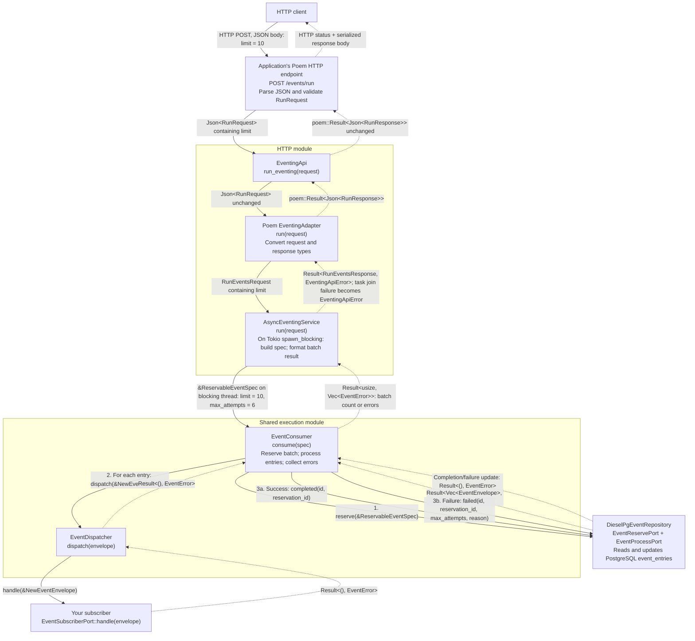

# mulac-eventing

## Module organization

- `src/execution/`: synchronous consumer, reservation specification, dispatcher,
  and subscriber port. HTTP triggers and application workers both use it. Direct
  gateways reuse the dispatcher without batch consumption.
- `src/http/`: shared HTTP contracts and the blocking-task bridge (`execution.rs`),
  plus Poem and Axum adapters.
- `src/application/`: envelopes, errors, storage ports, gateway, conversions, and
  reservation recovery.
- `src/domain/` and `src/infra_diesel/`: lifecycle policy and database implementation.

Import through `mulac_eventing::prelude`. Internal modules are private.

## Item failure isolation

Reservation is one transaction: malformed rows become `Failed`, and healthy
rows are returned without discarding the batch. Each consumer item contains
recoverable panics and attempts `Failed` on processing or completion errors,
then continues. Exhausted entries also stay `Failed`; the attempt cap still
prevents further automatic retries. No automatic path selects `Dead`.

Finalization still requires a working database/repository. Process termination,
abort-mode panics, and hung work require application-owned recovery; sweepers
must still be scheduled. See [the lifecycle and recovery contract](../../docs/item-failure-isolation.md)
for counts, diagnostics, retry timing, limitations, and PostgreSQL test commands.

## Two-phased event gateway dependency tree

`EventGateway::two_phased` separates recording an event from delivering it. The
gateway only records; the application must separately invoke the consumer. This
is deferred delivery, not a two-phase commit protocol.

The tree below shows constructor dependencies. The gateway and consumer must use
the same event store; they can share one repository through `Arc`.

```text
Phase 1: record
EventGateway::two_phased(store)
└── Arc<dyn EventStorePort>
    └── DieselPgEventRepository (or a custom implementation)
        └── DbPool → PostgreSQL event_entries table

Phase 2: deliver
EventConsumer::new(repository, dispatcher)
├── Arc<R: EventReservePort + EventProcessPort>
│   └── Same event repository/store as phase 1
└── Arc<EventDispatcher>
    └── Arc<dyn EventSubscriberPort>
        └── Application-supplied subscriber
            (the kernel supplies a subscriber registry)

Reservation recovery (schedule separately)
EventSweeper::new(port)
└── Arc<dyn EventSweepPort>
    └── Same event repository/store
```

### Runtime inputs and responsibilities

1. Call `gateway.dispatch(envelope)` with metadata containing a caller-supplied
   `event_id`. Success means the event was recorded, not delivered.
2. Call `consumer.consume(&ReservableEventSpec::new(limit))` from an
   application-owned worker or explicit batch trigger. The consumer reserves due
   events, calls the subscriber, and marks each event completed or failed.
3. Call `sweeper.sweep(&StaleEventSpec::new(timeout))` to recover expired
   reservations. Keep the sweeper and consumer `max_attempts` settings aligned.

`DieselPgEventRepository` implements all four storage ports and requires the
`diesel` feature, a database pool, and the event schema. Custom repositories can
implement the ports without Diesel. HTTP and Tokio features are not required for
this flow.

Subscriber effects and marking the event completed are separate calls, not one
atomic transaction, so subscribers must tolerate duplicate delivery.

## Poem: HTTP request through the structs and back

This diagram follows one request. The application mounts `EventingApi` under
`/events` in this example. Solid arrows are calls and dotted arrows are returns.
Calls below the consumer repeat for each reserved event.



### What changes at each boundary

| Struct                 | Receives               | Passes onward                                                                 | Returns to its caller                                                               |
| ---------------------- | ---------------------- | ----------------------------------------------------------------------------- | ----------------------------------------------------------------------------------- |
| `EventingApi`          | `Json<RunRequest>`     | Same request to adapter                                                       | `poem::Result<Json<RunResponse>>`                                                   |
| Poem `EventingAdapter` | `Json<RunRequest>`     | Validated `RunEventsRequest`                                                  | Converts validation error or service result to `Json<RunResponse>` or `poem::Error` |
| `AsyncEventingService` | `RunEventsRequest`     | `ReservableEventSpec { limit, max_attempts: 6 }` to consumer on blocking pool | Converts consumer result to `RunEventsResponse`, or returns task-join error         |
| `EventConsumer`        | `&ReservableEventSpec` | Reserved events to dispatcher; lifecycle updates to repository                | `Ok(count)` or `Err(Vec<EventError>)`                                               |
| `EventDispatcher`      | `&NewEventEnvelope`    | Same envelope to the subscriber                                               | `Ok(())` or `EventError`                                                            |

### What reaches the HTTP client

- **Batch succeeds:** HTTP 200 with, for example,
  `{ "processed": 3, "errors": [] }`. The count can be less than the limit.
- **Consumer returns errors:** HTTP 200 with
  `{ "processed": null, "errors": ["<error id>"] }`, one logged ID per failure. Other events in that batch may
  already have been delivered; this is not a transaction rollback.
- **Invalid request:** Poem rejects invalid input before the endpoint method, and
  the adapter also validates `limit` (`1..=1000`) when building
  `RunEventsRequest`. Both map to HTTP 400, and no events are consumed. A bad `limit` keeps its message,
  and a body that can't be parsed returns only a logged error ID.
- **Blocking task fails to join:** HTTP 500 whose body is a logged error ID.

### Finding an error by ID

Error IDs are logged through `tracing` with the fields `error_id`, `queue` and `error`,
so search your logs for the ID. The host must install a `tracing` subscriber. Failures log
at `error` and unparsable bodies at `warn`. `EnvFilter::from_default_env()` shows only
`error` when `RUST_LOG` is unset, so set `RUST_LOG=warn` to see the IDs for unparsable bodies.

This endpoint delivers events already recorded in storage; it does not submit new
events. The application constructs and supplies the consumer and its dependencies.
