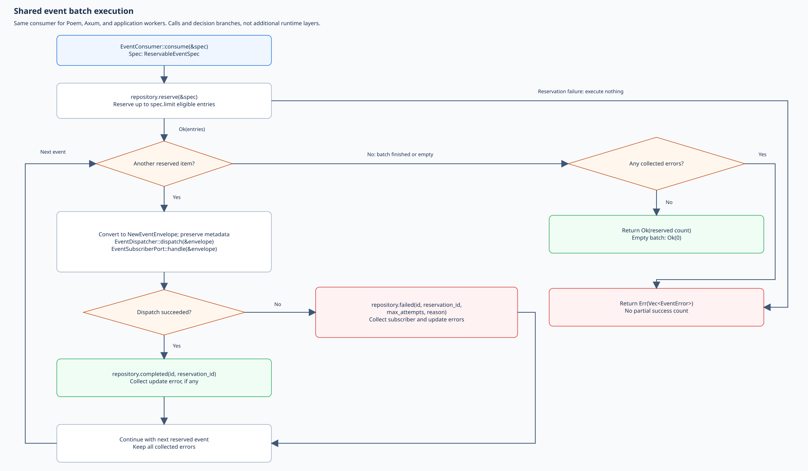
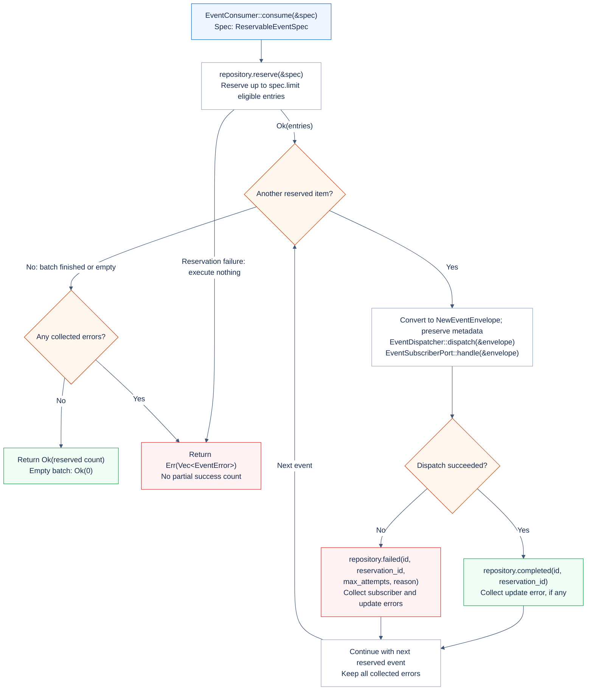
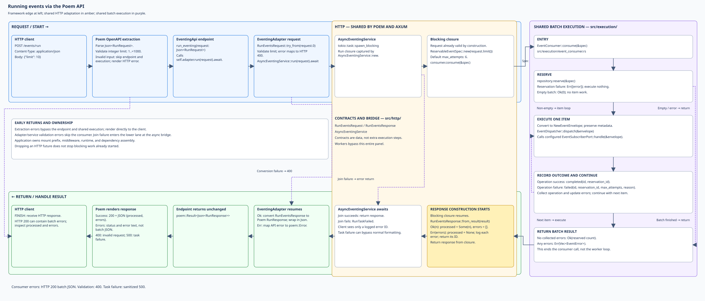
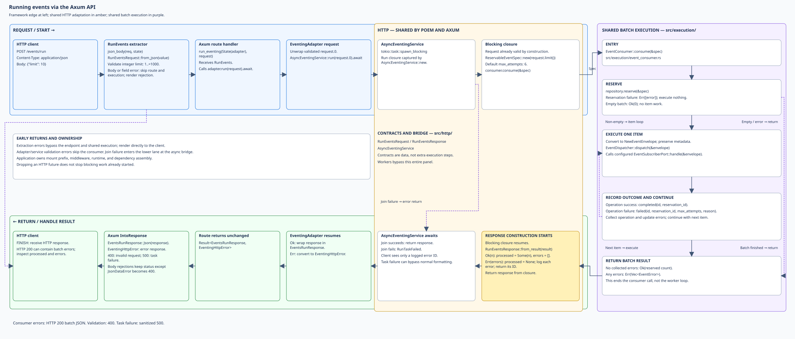
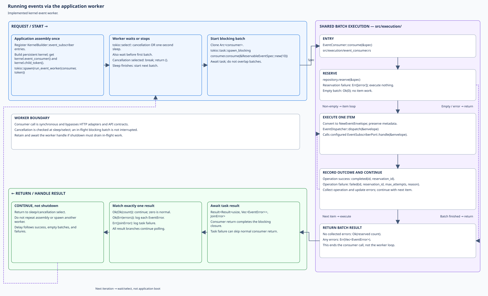
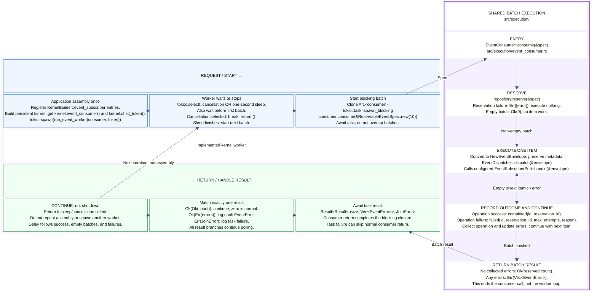

# Event batch processing flows

The event consumer dispatches **already-stored events** through an
`EventDispatcher` to its configured subscriber. These four views trace that
batch execution from Poem, Axum, or the implemented kernel event worker. Use
them to assemble dependencies and distinguish subscriber failures from HTTP
formatting or task failures.

Completion means subscriber dispatch returned successfully and storage accepted
the completion update. It is not an exactly-once guarantee or proof of every
downstream effect. The library dispatcher delegates to one
`EventSubscriberPort`; a kernel registry can provide routing and fan-out
behind that port.

Event recording and direct `EventGateway` dispatch are separate paths, not
steps in these batch flows. Reservation recovery must be scheduled separately;
neither the HTTP run endpoint nor the kernel event worker starts a sweeper.

## Reading the diagrams

The previews are **hand-arranged SVGs** with native, selectable text. Click an
image for full size. Editable Mermaid follows in an expandable section. Both
representations are maintained separately and must agree on behavior;
Mermaid's automatic layout is not a pixel-exact SVG reproduction. Caller
diagrams require Mermaid `block-beta` support; SVG previews do not.

Read the upper blue request/work lane left to right, enter the purple execution
panel on the right, and return right to left through the lower green lane.
Amber groups shared HTTP contracts and the blocking bridge; yellow highlights
where response construction begins. Workers bypass amber. Arrows represent
calls, returns, or labeled alternatives. Dashed SVG paths mark bypasses or
loop continuation. Stacked actions run top to bottom unless labeled as
alternative outcomes, not successive steps.

The detailed consumer diagram expands the purple panel. Its private
`src/execution/` files hold the consumer, dispatcher, and reservation spec.
`src/http/execution.rs` is the separate async HTTP bridge: it builds the spec
and formats results inside a blocking closure. It is not a second event
execution layer. There is no intermediate synchronous `EventingService` in
the current implementation. Application models, ports, and conversions remain
in `src/application/`.

## Shared batch execution

Editable Mermaid source (layout differs from SVG)

### Inputs and batch results

`EventConsumer::consume(&ReservableEventSpec)` reserves events and processes
them sequentially. `ReservableEventSpec::new(limit)` defaults to
`max_attempts = 6`; the spec is input data, not a service.

- Reservation failure returns `Err(vec![error])` immediately and dispatches nothing.
- An empty successful reservation returns `Ok(0)`.
- Per-event subscriber and lifecycle-update failures are collected. Later
  events are still attempted, even when an earlier event failed.
- With no errors, return `Ok(reserved_count)`; otherwise return
  `Err(Vec<EventError>)`, not a partial success count. Earlier successful
  subscriber work is not rolled back by a batch error.

With `DieselPgEventRepository`, reservation selects due received/failed events
below the attempt limit. Repository policy controls retry scheduling and
dead-state handling; the consumer does not retry a failed event immediately
inside its loop. Custom storage implements `EventReservePort` and
`EventProcessPort`. Align any separately scheduled sweeper's attempt limit.

### Subscriber boundary and metadata

Conversion from a stored `EventEnvelope` to `NewEventEnvelope` is infallible
here. It preserves event type, payload, and available metadata: event ID,
optional sequence, correlation ID, causation ID, and source. This consumer has
no inbox/outbox-style optional-reservation-ID rejection branch.

`EventDispatcher::dispatch` calls the configured subscriber's `handle` method.
With the kernel `EventSubscriberRegistry`, subscribers are selected by event
type and invoked sequentially until the first error. No matching subscribers
is successful. This is the registry's behavior, not an extra routing layer
inside the library dispatcher.

Successful dispatch calls `completed(...)`; subscriber failure calls
`failed(..., max_attempts, reason)`. An error from either lifecycle update is
collected too. If a later subscriber fails, effects from earlier subscribers
are not undone; retrying the event may invoke them again. Subscribers must
tolerate repeated delivery. Optional sequence supplies provenance, not an
ordering guarantee.

## Running via the Poem API

```mermaid
---
config:
  theme: base
  themeVariables:
    darkMode: false
    background: '#ffffff'
    primaryColor: '#ffffff'
    primaryTextColor: '#172b4d'
    secondaryColor: '#eff6ff'
    tertiaryColor: '#f5f0ff'
    textColor: '#172b4d'
    lineColor: '#405675'
    edgeLabelBackground: '#ffffff'
---
block-beta
    columns 7
    block:caller:4
        columns 4
        request_title["REQUEST / START →"]:4
        request_0["HTTP client<br/>POST /events/run<br/>Content-Type: application/json<br/>Body: {&quot;limit&quot;: 10}"]
        request_1["Poem OpenAPI extraction<br/>Parse Json&lt;RunRequest&gt;.<br/>Validate integer limit: 1..=1000.<br/>Invalid input: skip endpoint and execution; render HTTP error."]
        request_2["EventingApi endpoint<br/>run_eventing(request: Json&lt;RunRequest&gt;)<br/>Calls self.adapter.run(request).await."]
        request_3["EventingAdapter request<br/>RunEventsRequest::try_from(request.0)<br/>Validate limit; error maps to HTTP 400.<br/>AsyncEventingService::run(request).await"]
        edge_note["Extraction errors skip shared execution; alternatives are not sequential steps."]:4
        return_title["← RETURN / HANDLE RESULT"]:4
        response_0["HTTP client<br/>FINISH: receive HTTP response.<br/>HTTP 200 can contain batch errors; inspect processed and errors."]
        response_1["Poem renders response<br/>Success: 200 + JSON {processed, errors}.<br/>Errors: status and error text, not batch JSON.<br/>400: invalid request; 500: task failure."]
        response_2["Endpoint returns unchanged<br/>poem::Result&lt;Json&lt;RunResponse&gt;&gt;"]
        response_3["EventingAdapter resumes<br/>Ok: convert RunEventsResponse to Poem RunResponse; wrap in Json.<br/>Err: map API error to poem::Error."]
    end
    block:http:2
        columns 2
        http_title["HTTP — SHARED BY POEM AND AXUM<br/>src/http/"]:2
        request_4["AsyncEventingService<br/>tokio::task::spawn_blocking<br/>Run closure captured by AsyncEventingService::new."]
        request_5["Blocking closure<br/>Request already valid by construction.<br/>ReservableEventSpec::new(request.limit())<br/>Default max_attempts: 6.<br/>consumer.consume(&amp;spec)"]
        contracts["RunEventsRequest<br/>RunEventsResponse<br/>Contracts are data; worker bypasses this panel."]:2
        response_4["AsyncEventingService awaits<br/>Join succeeds: return response.<br/>Join fails: RunTaskFailed.<br/>Client sees only a logged error ID.<br/>Task failure can bypass normal formatting."]
        response_5["RESPONSE CONSTRUCTION STARTS<br/>Blocking closure resumes.<br/>RunEventsResponse::from_result(result)<br/>Ok(n): processed = Some(n), errors = [].<br/>Err(errors): processed = None; log each error; return its ID.<br/>Return response from closure."]
    end
    block:core
        columns 1
        core_title["SHARED BATCH EXECUTION<br/>src/execution/"]
        core_0["ENTRY<br/>EventConsumer::consume(&amp;spec)<br/>src/execution/event_consumer.rs"]
        space
        core_1["RESERVE<br/>repository.reserve(&amp;spec)<br/>Reservation failure: Err([error]); execute nothing.<br/>Empty batch: Ok(0); no item work."]
        space
        core_2["EXECUTE ONE ITEM<br/>Convert to NewEventEnvelope; preserve metadata.<br/>EventDispatcher::dispatch(&amp;envelope)<br/>Calls configured EventSubscriberPort::handle(&amp;envelope)."]
        space
        core_3["RECORD OUTCOME AND CONTINUE<br/>Operation success: completed(id, reservation_id).<br/>Operation failure: failed(id, reservation_id, max_attempts, reason).<br/>Collect operation and update errors; continue with next item."]
        space
        core_4["RETURN BATCH RESULT<br/>No collected errors: Ok(reserved count).<br/>Any errors: Err(Vec&lt;EventError&gt;).<br/>This ends the consumer call, not the worker loop."]
    end
    request_0 --> request_1
    response_1 --> response_0
    request_1 --> request_2
    response_2 --> response_1
    request_2 --> request_3
    response_3 --> response_2
    request_3 --> request_4
    response_4 --> response_3
    request_4 --> request_5
    response_5 --> response_4
    request_5 -- "Spec" --> core_0
    core_4 -- "Batch result" --> response_5
    core_0 --> core_1
    core_1 -- "Non-empty batch" --> core_2
    core_1 -- "Empty or reservation error" --> core_4
    core_2 --> core_3
    core_3 -- "Next item" --> core_2
    core_3 -- "Batch finished" --> core_4
    request_1 -- "Extraction error; skip execution" --> response_1
    request_4 -- "Join failure" --> response_4
    request_3 -- "Conversion validation error" --> response_3
    classDef neutral fill:#ffffff,stroke:#94a3b8,color:#172b4d
    classDef request fill:#eff6ff,stroke:#0969da,color:#172b4d
    classDef response fill:#f0fff4,stroke:#1a7f37,color:#172b4d
    classDef highlight fill:#fff1b8,stroke:#bf8700,color:#172b4d
    classDef decision fill:#fff7ed,stroke:#c2410c,color:#172b4d
    classDef success fill:#f0fdf4,stroke:#16a34a,color:#172b4d
    classDef failure fill:#fef2f2,stroke:#dc2626,color:#172b4d
    classDef core fill:#f5f0ff,stroke:#8250df,color:#172b4d
    classDef http fill:#fff8e8,stroke:#bf8700,color:#172b4d
    class request_0,request_1,request_2,request_3,request_title request
    class response_0,response_1,response_2,response_3,return_title response
    style core fill:#f5f0ff,stroke:#8250df,stroke-width:3px,color:#172b4d
    style http fill:#fff8e8,stroke:#bf8700,stroke-width:3px,color:#172b4d
    class response_5 highlight
```

Editable Mermaid source (layout differs from SVG)

### What changes at each boundary

| Boundary                    | Receives and does                                                   | Returns                                            |
| --------------------------- | ------------------------------------------------------------------- | -------------------------------------------------- |
| Poem OpenAPI extraction     | Parse `Json<RunRequest>` and validate integer limit `1..=1000`      | HTTP error, or invoke endpoint                     |
| `EventingApi::run_eventing` | Forward request to `EventingAdapter`                                | Forward `poem::Result<Json<RunResponse>>`          |
| `EventingAdapter::run`      | Validate conversion with `RunEventsRequest::try_from`; await bridge | Convert response to Poem wrapper, or map API error |
| `AsyncEventingService::run` | Spawn the closure captured during construction                      | `Result<RunEventsResponse, EventingApiError>`      |
| Blocking closure            | Build `ReservableEventSpec`; call consumer; format result           | `RunEventsResponse`                                |

`RunEventsRequest` is valid by construction. `new`, `from_json`, and
deserialization all enforce `1..=1000`, and callers read the private limit
through `limit()`. The Poem adapter uses a fallible conversion, so manually
constructed wire wrappers are also validated. A conversion error maps to 400
without entering the bridge or consumer.

`AsyncEventingService::new` captures an application-supplied
`Arc<EventConsumer<R>>`. Inside its blocking closure, it builds
`ReservableEventSpec::new(request.limit())`, invokes `consumer.consume`, and
calls `RunEventsResponse::from_result`. **This last call begins normal response
construction**, after consumer execution, still on the blocking thread.
No synchronous service object is called between the bridge and consumer.

The async bridge returns `Ok(response)` after a successful join. Its runtime
error path is a sanitized join failure, not a consumer failure: consumer errors
have already been converted into the response. The adapter converts that shared
response into Poem's wire `RunResponse` without changing its meaning.

### What reaches the HTTP client

| Outcome                                        | Response                                                          |
| ---------------------------------------------- | ----------------------------------------------------------------- |
| Successful batch                               | HTTP 200: `{"processed":3,"errors":[]}`; count may be below limit |
| Empty batch                                    | HTTP 200: `{"processed":0,"errors":[]}`                           |
| Consumer errors, including reservation failure | HTTP 200: `{"processed":null,"errors":["…"]}`                     |
| Invalid fields or limit outside `1..=1000`     | HTTP 400; no consumer invocation                                  |
| Blocking-task join failure                     | HTTP 500: a logged error ID                                       |

Task failure can bypass normal response construction; early validation errors
skip shared execution. HTTP errors do not use the batch JSON shape. Body
extraction is framework-specific; not every content-type or body-size rejection
must be 400.

`/events` is an example application-owned prefix; the endpoint declares
`POST /run`. Authentication, authorization, middleware, runtime, and consumer
assembly belong to the host. The bridge creates no dispatcher, worker, pool, or
runtime. Dropping a disconnected client's HTTP future does not stop blocking
work already underway.

## Running via the Axum API

```mermaid
---
config:
  theme: base
  themeVariables:
    darkMode: false
    background: '#ffffff'
    primaryColor: '#ffffff'
    primaryTextColor: '#172b4d'
    secondaryColor: '#eff6ff'
    tertiaryColor: '#f5f0ff'
    textColor: '#172b4d'
    lineColor: '#405675'
    edgeLabelBackground: '#ffffff'
---
block-beta
    columns 7
    block:caller:4
        columns 4
        request_title["REQUEST / START →"]:4
        request_0["HTTP client<br/>POST /events/run<br/>Content-Type: application/json<br/>Body: {&quot;limit&quot;: 10}"]
        request_1["RunEvents extractor<br/>json_body(req, state)<br/>RunEventsRequest::from_json(value)<br/>Validate integer limit: 1..=1000.<br/>Body or field error: skip route and execution; render rejection."]
        request_2["Axum route handler<br/>run_eventing(State(adapter), request)<br/>Receives RunEvents.<br/>Calls adapter.run(request).await."]
        request_3["EventingAdapter request<br/>Unwrap validated request.0.<br/>AsyncEventingService::run(request.0).await"]
        edge_note["Extraction errors skip shared execution; alternatives are not sequential steps."]:4
        return_title["← RETURN / HANDLE RESULT"]:4
        response_0["HTTP client<br/>FINISH: receive HTTP response.<br/>HTTP 200 can contain batch errors; inspect processed and errors."]
        response_1["Axum IntoResponse<br/>EventsRunResponse: Json(response).<br/>EventingHttpError: error response.<br/>400: invalid request; 500: task failure.<br/>Body rejections keep status except JsonDataError becomes 400."]
        response_2["Route returns unchanged<br/>Result&lt;EventsRunResponse, EventingHttpError&gt;"]
        response_3["EventingAdapter resumes<br/>Ok: wrap response in EventsRunResponse.<br/>Err: convert to EventingHttpError."]
    end
    block:http:2
        columns 2
        http_title["HTTP — SHARED BY POEM AND AXUM<br/>src/http/"]:2
        request_4["AsyncEventingService<br/>tokio::task::spawn_blocking<br/>Run closure captured by AsyncEventingService::new."]
        request_5["Blocking closure<br/>Request already valid by construction.<br/>ReservableEventSpec::new(request.limit())<br/>Default max_attempts: 6.<br/>consumer.consume(&amp;spec)"]
        contracts["RunEventsRequest<br/>RunEventsResponse<br/>Contracts are data; worker bypasses this panel."]:2
        response_4["AsyncEventingService awaits<br/>Join succeeds: return response.<br/>Join fails: RunTaskFailed.<br/>Client sees only a logged error ID.<br/>Task failure can bypass normal formatting."]
        response_5["RESPONSE CONSTRUCTION STARTS<br/>Blocking closure resumes.<br/>RunEventsResponse::from_result(result)<br/>Ok(n): processed = Some(n), errors = [].<br/>Err(errors): processed = None; log each error; return its ID.<br/>Return response from closure."]
    end
    block:core
        columns 1
        core_title["SHARED BATCH EXECUTION<br/>src/execution/"]
        core_0["ENTRY<br/>EventConsumer::consume(&amp;spec)<br/>src/execution/event_consumer.rs"]
        space
        core_1["RESERVE<br/>repository.reserve(&amp;spec)<br/>Reservation failure: Err([error]); execute nothing.<br/>Empty batch: Ok(0); no item work."]
        space
        core_2["EXECUTE ONE ITEM<br/>Convert to NewEventEnvelope; preserve metadata.<br/>EventDispatcher::dispatch(&amp;envelope)<br/>Calls configured EventSubscriberPort::handle(&amp;envelope)."]
        space
        core_3["RECORD OUTCOME AND CONTINUE<br/>Operation success: completed(id, reservation_id).<br/>Operation failure: failed(id, reservation_id, max_attempts, reason).<br/>Collect operation and update errors; continue with next item."]
        space
        core_4["RETURN BATCH RESULT<br/>No collected errors: Ok(reserved count).<br/>Any errors: Err(Vec&lt;EventError&gt;).<br/>This ends the consumer call, not the worker loop."]
    end
    request_0 --> request_1
    response_1 --> response_0
    request_1 --> request_2
    response_2 --> response_1
    request_2 --> request_3
    response_3 --> response_2
    request_3 --> request_4
    response_4 --> response_3
    request_4 --> request_5
    response_5 --> response_4
    request_5 -- "Spec" --> core_0
    core_4 -- "Batch result" --> response_5
    core_0 --> core_1
    core_1 -- "Non-empty batch" --> core_2
    core_1 -- "Empty or reservation error" --> core_4
    core_2 --> core_3
    core_3 -- "Next item" --> core_2
    core_3 -- "Batch finished" --> core_4
    request_1 -- "Extraction error; skip execution" --> response_1
    request_4 -- "Join failure" --> response_4
    classDef neutral fill:#ffffff,stroke:#94a3b8,color:#172b4d
    classDef request fill:#eff6ff,stroke:#0969da,color:#172b4d
    classDef response fill:#f0fff4,stroke:#1a7f37,color:#172b4d
    classDef highlight fill:#fff1b8,stroke:#bf8700,color:#172b4d
    classDef decision fill:#fff7ed,stroke:#c2410c,color:#172b4d
    classDef success fill:#f0fdf4,stroke:#16a34a,color:#172b4d
    classDef failure fill:#fef2f2,stroke:#dc2626,color:#172b4d
    classDef core fill:#f5f0ff,stroke:#8250df,color:#172b4d
    classDef http fill:#fff8e8,stroke:#bf8700,color:#172b4d
    class request_0,request_1,request_2,request_3,request_title request
    class response_0,response_1,response_2,response_3,return_title response
    style core fill:#f5f0ff,stroke:#8250df,stroke-width:3px,color:#172b4d
    style http fill:#fff8e8,stroke:#bf8700,stroke-width:3px,color:#172b4d
    class response_5 highlight
```

Editable Mermaid source (layout differs from SVG)

Axum's `RunEvents` extractor reads JSON via `json_body` and calls
`RunEventsRequest::from_json` before the `run_eventing` handler. Extraction or
validation errors skip the endpoint, adapter, bridge, and consumer. The handler
forwards the validated request to `EventingAdapter::run`, which unwraps
`request.0` and awaits `AsyncEventingService`.

The blocking closure is identical to Poem's: build spec, consume, format the
batch result. On return, `EventsRunResponse` wraps `RunEventsResponse` and its
`IntoResponse` renders JSON directly, without Poem wrapper conversion. The
route returns `Result<EventsRunResponse, EventingHttpError>` unchanged.

Consumer errors remain **HTTP 200** with `processed: null`; empty success has
`processed: 0`. Validation errors map to 400; task-join failures map to sanitized
500. API errors are plain text rather than `{processed, errors}` JSON.

`EventingHttpError::Body` uses `rejection_response`: `JsonDataError` becomes 400,
while other Axum body-rejection statuses are preserved, including unsupported
content type and configured size limits. These errors render directly without
consumer execution or normal response formatting.

`event_routes(service)` installs adapter state and declares relative `/run`.
The host chooses `/events` and middleware. This endpoint dispatches stored
events, not new submissions. Disconnect behavior is the same as Poem.

## Running via the application worker

Editable Mermaid source (layout differs from SVG)

This is the **implemented kernel worker** in `kernel/src/workers.rs`, not a new
worker API. During assembly, register subscribers with
`KernelBuilder::event_subscriber`, build the persistent kernel, obtain
`kernel.event_consumer()` and `kernel.child_token()`, and spawn
`run_event_worker` through the kernel prelude. The application owns that task.

The loop sleeps one second before its first batch. It clones the consumer,
runs `consume(&ReservableEventSpec::new(10))` in `spawn_blocking`, then awaits
the task before returning to the sleep/cancellation select. There are no
overlapping batches within one worker. One second is a delay after each batch,
not a fixed start-to-start interval. Sleeping does not override repository
retry eligibility; the spec uses six maximum attempts.

| Task result       | Worker action                         |
| ----------------- | ------------------------------------- |
| `Ok(Ok(count))`   | No error log; zero is normal          |
| `Ok(Err(errors))` | Log each error as `event worker: {e}` |
| `Err(JoinError)`  | Log `event worker panicked: {e}`      |

All result branches continue polling. Cancellation selected at sleep/select
exits the worker with `()`. `kernel.shutdown()` cancels its token but does not
interrupt a blocking batch already running. Retain and await the separately
spawned worker's `JoinHandle` to drain it: `PersistentKernelHandle::wait()` does
not join separately spawned workers.

The worker calls the consumer directly. No HTTP request, API contract,
`AsyncEventingService`, or `RunEventsResponse` construction is involved.
The HTTP limit restriction is not validation in `ReservableEventSpec::new`.

## Source references and maintenance

- [Consumer](src/execution/event_consumer.rs), [reservation spec](src/execution/reservable.rs), and [dispatcher/subscriber port](src/execution/event_dispatcher.rs)
- [Envelope conversions](src/application/conversions.rs) and [storage ports](src/application/ports.rs)
- [HTTP contracts](src/http/contract.rs) and [async execution bridge](src/http/execution.rs)
- [Poem endpoint](src/http/poem/routes.rs) and [adapter](src/http/poem/adapter.rs)
- [Axum routes](src/http/axum/routes.rs) and [extractor/adapter](src/http/axum/adapter.rs)
- [Kernel subscriber registry](../../kernel/src/event_subscriber_registry.rs), [implemented polling worker](../../kernel/src/workers.rs), and [assembly/shutdown](../../kernel/src/lib.rs)
- [Diesel repository](src/infra_diesel/repository.rs) and [separately scheduled recovery](src/application/stale_event_sweep.rs)
- [Public prelude](src/lib.rs) and [feature flags](Cargo.toml)
- [Poem HTTP tests](../../test_apps/http_adapters/tests/eventing_poem.rs) and [Axum HTTP tests](../../test_apps/http_adapters/tests/eventing_axum.rs)
- [Shared body rejection handling](../mulac_http/src/body.rs) and [Poem wire contracts](../mulac_http/src/poem.rs)

External callers use `mulac_eventing::prelude`, its `poem`/`axum` re-exports,
and `mulac_kernel::prelude`. Linked private files explain implementation, not
supported import paths. HTTP adapters enable the Tokio bridge; direct consumer
calls do not require HTTP or Tokio. The `api` feature exposes contracts;
`api-tokio` adds the async bridge. Diesel is independently feature-gated.

When behavior changes:

1. Recheck implementation and tests, then update prose, Mermaid, and SVG
   together. Keep each caller's shared panel consistent with the detailed flow.
2. Render all four Mermaid blocks with a `block-beta`-capable renderer. Keep
   extracted `.mmd` files and automatic previews in ignored scratch space;
   never replace the hand-arranged SVGs with automatic exports.
3. Parse SVGs as XML and verify titles, descriptions, links, and full-size
   readability. Check text bounds and arrow routing; preserve native text and
   no external assets.
4. Review success, empty/reservation-failure batches, subscriber/update errors,
   metadata preservation, HTTP validation/task errors, and worker cancellation.
   Run the library and HTTP adapter tests.

Recording, direct gateway dispatch, and recovery remain outside these four
views; do not silently add them to the batch path.
