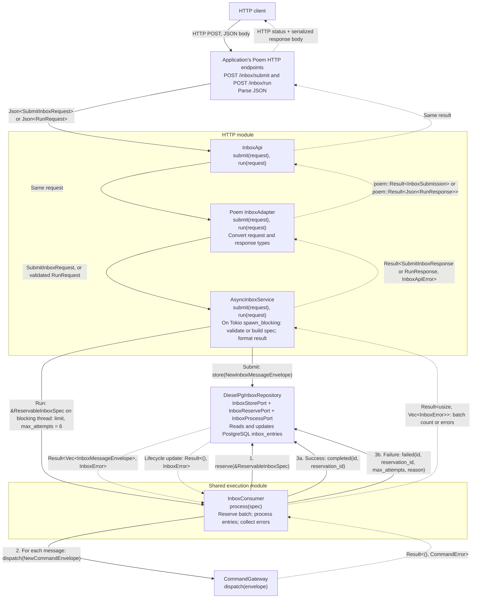

# mulac-inbox

## Module organization

- `src/execution/`: synchronous consumer and reservation specification. HTTP
  triggers and applications both call it.
- `src/http/`: shared HTTP contracts and the blocking-task bridge (`execution.rs`),
  plus Poem and Axum adapters.
- `src/application/`: envelopes, errors, storage and transport ports, conversions,
  and reservation recovery.
- `src/domain/` and `src/infra_diesel/`: lifecycle policy and database implementation.
- `src/amqp_consumption.rs`: optional AMQP transport and worker (feature `amqp`).

Import through `mulac_inbox::prelude`. Internal modules are private.

## Item failure isolation

Reservation is one transaction: malformed rows become `Failed`, and healthy
rows are returned without discarding the batch. Each consumer item contains
recoverable panics and attempts `Failed` on processing or completion errors,
then continues. Exhausted entries also stay `Failed`; the attempt cap still
prevents further automatic retries. No automatic path selects `Dead`.

Finalization still requires a working database/repository. Process termination,
abort-mode panics, and hung work require application-owned recovery; sweepers
must still be scheduled. See [the lifecycle and recovery contract](../../docs/item-failure-isolation.md)
for counts, diagnostics, retry timing, limitations, and PostgreSQL test commands.

## Dependency tree

Storing a message and turning it into a command are separate steps. The store and
consumer must use the same inbox table; they can share one repository through `Arc`.

```text
Store
AmqpWorker::new(channel, queue, store), or POST /submit
└── Arc<dyn InboxStorePort>
    └── DieselPgInboxRepository (or a custom implementation)
        └── DbPool → PostgreSQL inbox_entries table

Process
InboxConsumer::new(repository, gateway)
├── Arc<R: InboxReservePort + InboxProcessPort>
│   └── Same inbox repository/store as above
└── CommandGateway
    ├── CommandGateway::two_phased(store): records commands for later execution
    └── CommandGateway::direct(dispatcher): runs command handlers immediately

Reservation recovery (schedule separately)
ReservationSweeper::new(port)
└── Arc<dyn InboxSweepPort>
    └── Same inbox repository/store
```

### Runtime inputs and responsibilities

1. Store each message through `InboxStorePort::store`. The AMQP worker does this and
   acknowledges the delivery only after storage succeeds. A duplicate `message_id`
   is accepted and leaves the stored row unchanged.
2. Call `consumer.process(&ReservableInboxSpec::new(limit))` from an
   application-owned worker or explicit batch trigger. The consumer reserves due
   messages, sends a command for each through the gateway, and marks each message
   completed or failed. A message's `routing_key` becomes its command type.
3. Call `sweeper.sweep(&StaleReservationSpec::new(timeout))` to recover expired
   reservations. Keep the sweeper and consumer `max_attempts` settings aligned.

`DieselPgInboxRepository` implements all four storage ports and requires the
`diesel` feature, a database pool, and the inbox schema. Custom repositories can
implement the ports without Diesel.

Dispatching a command and marking the message completed are separate calls, not one
atomic transaction, so downstream processing must tolerate duplicates.

## Poem: HTTP requests through the structs and back

This diagram follows both operations. The application mounts `InboxApi` under
`/inbox` in this example. Solid arrows are calls and dotted arrows are returns. Calls
below the consumer repeat for each reserved message.



### What changes at each boundary

| Struct                      | Receives               | Passes onward                                                                 | Returns to its caller                                                       |
| --------------------------- | ---------------------- | ----------------------------------------------------------------------------- | --------------------------------------------------------------------------- |
| `InboxApi`                  | Poem `Json` request    | Same request to adapter                                                       | `poem::Result` response                                                     |
| Poem `InboxAdapter`         | Poem `Json` request    | `SubmitInboxRequest`, or validated `RunRequest`                               | Converts errors to `poem::Error`; submission success becomes `202 Accepted` |
| `AsyncInboxService::submit` | `SubmitInboxRequest`   | Validated `NewInboxMessageEnvelope` to the store on blocking pool             | `SubmitInboxResponse`, or a validation, storage, or task-join error         |
| `AsyncInboxService::run`    | `RunRequest`           | `ReservableInboxSpec { limit, max_attempts: 6 }` to consumer on blocking pool | Converts consumer result to `RunResponse`, or returns task-join error       |
| `InboxConsumer`             | `&ReservableInboxSpec` | Commands to gateway; lifecycle updates to repository                          | `Ok(count)` or `Err(Vec<InboxError>)`                                       |

### What reaches the HTTP client

- **Submission stored:** HTTP 202 with `{ "message_id": "..." }`. A missing
  `message_id` is generated as a UUID v7.
- **Invalid submission:** HTTP 400 with Mulac's validation text, and nothing is stored.
- **Submission fails:** HTTP 500 whose body is a logged error ID.
- **Batch succeeds:** HTTP 200 with, for example,
  `{ "processed": 3, "errors": [] }`. The count can be less than the limit.
- **Consumer returns errors:** HTTP 200 with
  `{ "processed": null, "errors": ["<error id>"] }`, one logged ID per failure. Other messages in that batch may
  already have succeeded; this is not a transaction rollback.
- **Invalid batch request:** Poem rejects invalid input before the endpoint method,
  and the adapter also validates `limit` (`1..=1000`) when building `RunRequest`.
  Both map to HTTP 400, and no messages are consumed. A bad `limit` keeps its message,
  and a body that can't be parsed returns only a logged error ID.
- **Blocking batch task fails to join:** HTTP 500 whose body is a logged error ID.

### Finding an error by ID

Error IDs are logged through `tracing` with the fields `error_id`, `queue` and `error`,
so search your logs for the ID. The host must install a `tracing` subscriber. Failures log
at `error` and unparsable bodies at `warn`. `EnvFilter::from_default_env()` shows only
`error` when `RUST_LOG` is unset, so set `RUST_LOG=warn` to see the IDs for unparsable bodies.

The application constructs and supplies the store, consumer, and command gateway, or
uses `AsyncInboxService::from_postgres(pool)`, which shares one repository and records
commands through a two-phased gateway.
