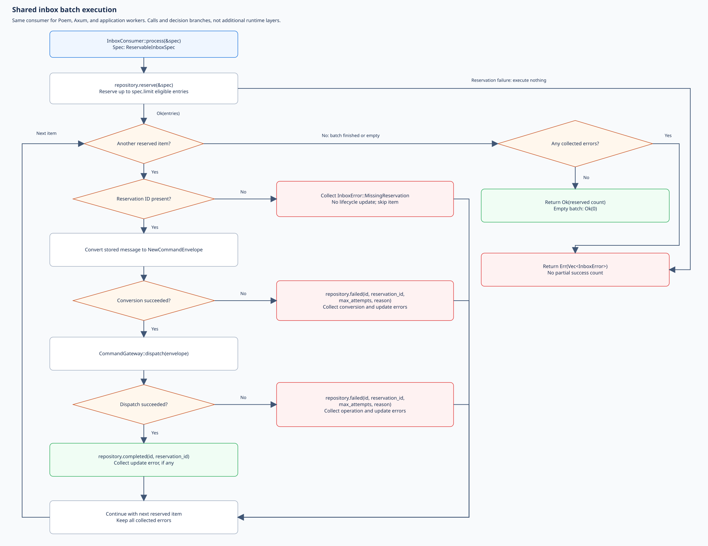
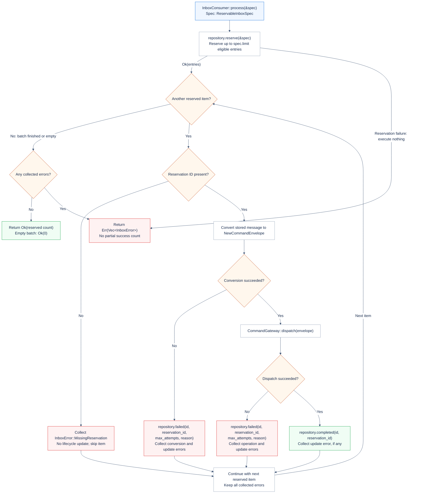
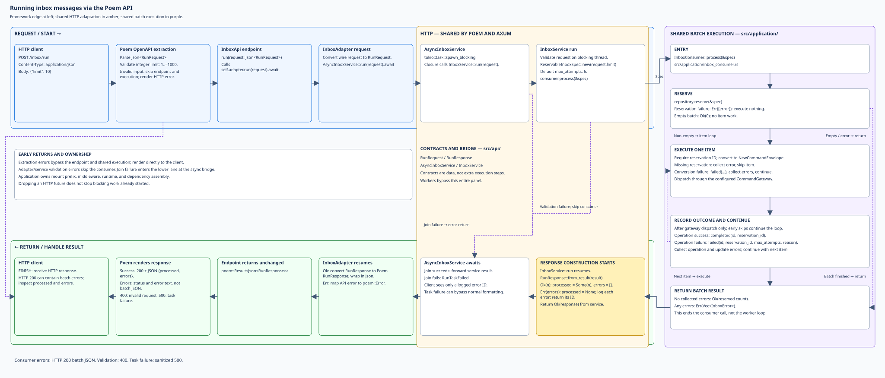
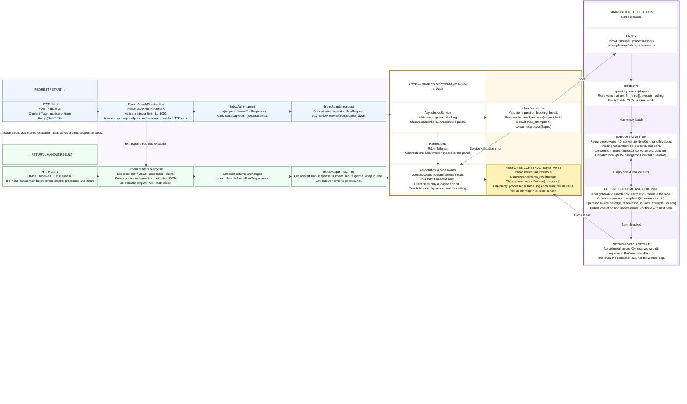
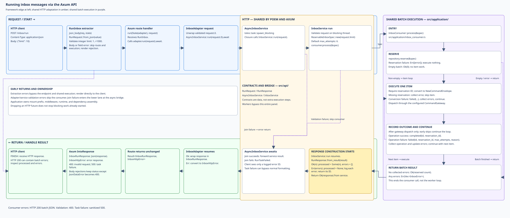
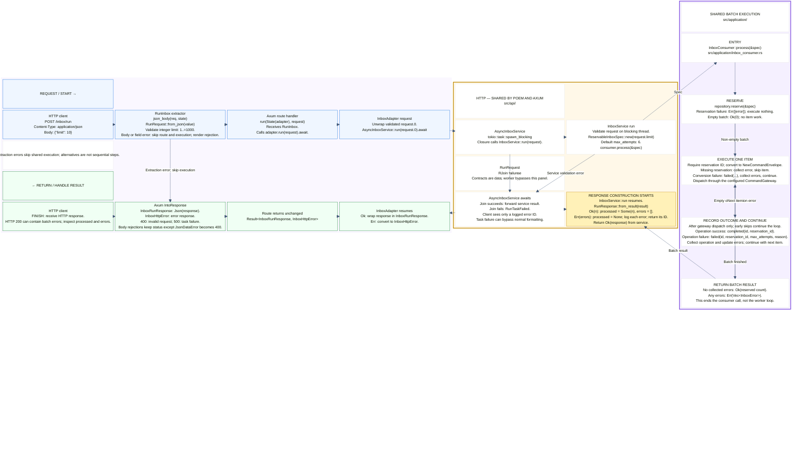
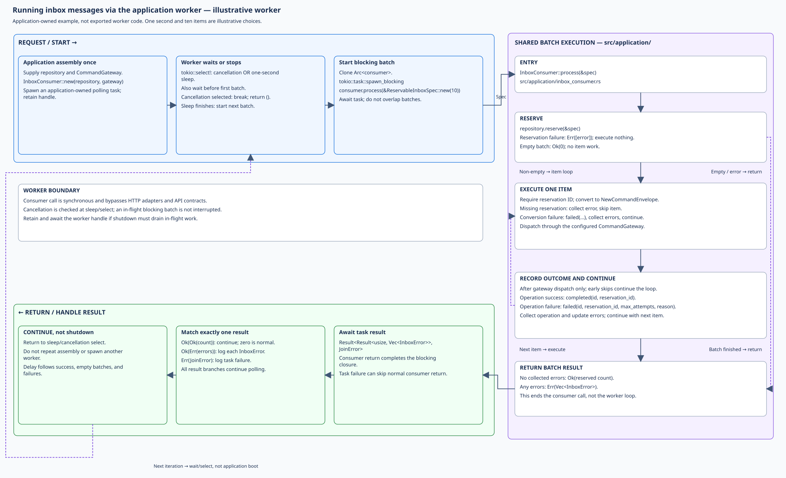
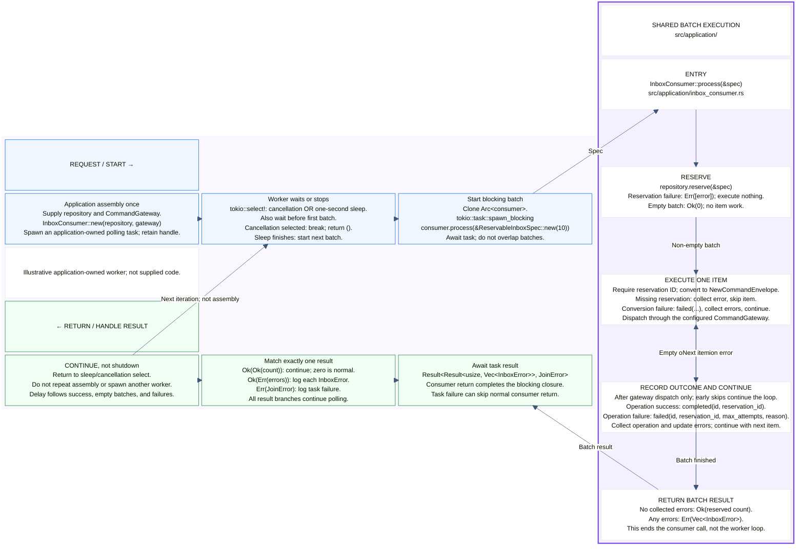

# Inbox batch processing flows

The inbox consumer hands **already-stored messages** to a configured command
gateway. These four views trace the same batch execution through Poem, Axum,
or an application-owned polling worker. Use them to assemble dependencies and
locate processing failures versus HTTP response failures.

Completion means the command gateway accepted the command. With
`CommandGateway::two_phased`, that means recording it for later consumption,
not executing its handler. With `CommandGateway::direct`, dispatch executes
synchronously. `InboxService::from_postgres` configures the two-phased gateway;
the consumer itself accepts either mode.

HTTP submission (`POST /submit` relative to the mount prefix), AMQP reception,
and inbox recording precede these flows. Reservation recovery is scheduled
separately; neither a run request nor the illustrated worker starts a sweeper.
The inbox `AmqpWorker` records incoming messages: it is not a stored-message
batch-processing worker.

## Reading the diagrams

The previews are **hand-arranged SVGs** with native, selectable text. Click an
image for full size. Editable Mermaid is below each image in an expandable
section. The two representations are maintained separately and must agree on
behavior; Mermaid's automatic layout is not a pixel-exact SVG reproduction.
Caller diagrams require Mermaid `block-beta` support; SVG previews do not.

Read the upper blue request/work lane left to right, enter the purple shared
batch-execution panel on the right, and return right to left through the lower
green lane. Amber groups HTTP contracts and services shared by Poem and Axum;
yellow marks where normal response construction begins. Workers bypass amber.
Arrows indicate calls, returns, or labeled alternatives. Dashed SVG paths mark
bypasses or loop continuation. Actions within a box read top to bottom, except
branches explicitly labeled as alternatives.

The detailed consumer diagram expands the purple panel's decisions. These are
responsibility boundaries, not new runtime layers: batch logic is in private
`src/application/` modules; contracts, the synchronous service, and the async
bridge are in `src/api/`. Framework extraction and rendering are outside both.

## Shared batch execution

[](flow.inbox-consumer.svg)

<details>
<summary>Editable Mermaid source (layout differs from SVG)</summary>



</details>

### Inputs and batch results

`InboxConsumer::process(&ReservableInboxSpec)` reserves a batch and processes
messages sequentially. `ReservableInboxSpec::new(limit)` defaults to
`max_attempts = 6`; the specification is input data, not a service.

- Reservation failure returns `Err(vec![error])` immediately, executing nothing.
- An empty successful reservation returns `Ok(0)`.
- Per-message processing errors and lifecycle-update errors are collected;
  later messages are still attempted.
- With no collected errors, return `Ok(reserved_count)`. Otherwise return
  `Err(Vec<InboxError>)`, not a partial success count. Some messages may already
  have succeeded when the batch returns errors.

With `DieselPgInboxRepository`, reservation selects due received/failed messages
below the attempt limit. Retry scheduling and dead-state policy belong to the
repository, not an immediate retry loop inside the consumer. Custom storage
implements `InboxReservePort` and `InboxProcessPort`. Keep a separately
scheduled sweeper's maximum attempts aligned with the consumer.

### Conversion and command handoff

1. A missing reservation ID yields `InboxError::MissingReservation`; skip the
   message without conversion, dispatch, or a lifecycle update.
2. Convert to `NewCommandEnvelope`. `routing_key` becomes the command type, and
   conversion creates a new UUID v7 command ID. Payload, correlation ID, and
   source are preserved; the message ID becomes command causation ID.
3. A missing routing key fails conversion. Call `failed(...)`, collect both
   conversion and update errors, and continue. This is not the outbox's
   blank-routing-key check or its immediate `dead(...)` branch.
4. Call `CommandGateway::dispatch`. Success calls `completed(...)`; failure
   calls `failed(...)` and is reported as `InboxError::PublishFailed`. Collect
   any lifecycle-update error too.

With a two-phased gateway, command execution requires a later command-consumer
call. Command recording, direct handler effects, and inbox completion are
separate operations, not one transaction. Conversion generates a fresh command
ID on each attempt, so a retry can repeat downstream work. Inbox message
deduplication is not an exactly-once command-execution guarantee.

## Running via the Poem API

[](flow-poem-api.svg)

<details>
<summary>Editable Mermaid source (layout differs from SVG)</summary>



</details>

### What changes at each boundary

| Boundary                 | Receives and does                                              | Returns                                                       |
| ------------------------ | -------------------------------------------------------------- | ------------------------------------------------------------- |
| Poem OpenAPI extraction  | Parse `Json<RunRequest>` and validate integer limit `1..=1000` | HTTP error, or invoke endpoint                                |
| `InboxApi::run`          | Forward wire request to `InboxAdapter`                         | Forward `poem::Result<Json<RunResponse>>`                     |
| `InboxAdapter::run`      | Copy wire limit into shared `RunRequest`; await async service  | Convert shared result to Poem `RunResponse`, or map API error |
| `AsyncInboxService::run` | Use `spawn_blocking` to call synchronous service               | Service result, or sanitized task-join error                  |
| `InboxService::run`      | Validate request, build spec, call `consumer.process`          | Format batch result using `RunResponse::from_result`          |

Poem's wire `RunRequest` and `RunResponse` are distinct types from the shared
inbox contracts with the same names. They preserve the same limit and
`{processed, errors}` meaning. The application supplies an assembled service;
the wrappers do not construct its repository or command gateway. Although
`InboxService` also owns a recorder for submission, `/run` does not invoke it.

**Normal response construction begins after the consumer returns**, in
`InboxService::run`, on the blocking thread. The async service awaits that
task, the adapter wraps the result for Poem, and the endpoint forwards it.
Gateway and repository returns are still batch execution, not HTTP formatting.
Validation failure skips the consumer; task failure can bypass normal response
construction entirely.

### What reaches the HTTP client

| Outcome                                        | Response                                                          |
| ---------------------------------------------- | ----------------------------------------------------------------- |
| Successful batch                               | HTTP 200: `{"processed":3,"errors":[]}`; count may be below limit |
| Empty batch                                    | HTTP 200: `{"processed":0,"errors":[]}`                           |
| Consumer errors, including reservation failure | HTTP 200: `{"processed":null,"errors":["…"]}`                     |
| Invalid fields or limit outside `1..=1000`     | HTTP 400; no consumer invocation                                  |
| Blocking-task join failure                     | HTTP 500: a logged error ID                                       |

HTTP errors are not the successful-status batch JSON shape. Body extraction
is framework-specific; do not assume every possible content-type or body-size
rejection is HTTP 400.

`/inbox` is an example application-owned prefix; the endpoint declares
`POST /run`. Authentication, authorization, middleware, and the Tokio runtime
belong to the host. No background worker is started by the service. Dropping
the HTTP future after a disconnect does not stop blocking work already started.

## Running via the Axum API

[](flow.axum-api.svg)

<details>
<summary>Editable Mermaid source (layout differs from SVG)</summary>



</details>

The `RunInbox` extractor reads JSON with `json_body` and calls
`RunRequest::from_json` **before** invoking the `run` route handler. Invalid
fields or limits skip the handler, adapter, and consumer. The route calls
`InboxAdapter::run`, which unwraps `request.0` and awaits `AsyncInboxService`.
The same synchronous service and consumer path is used as in Poem.

On return, the adapter wraps the shared `RunResponse` in `InboxRunResponse`.
Its `IntoResponse` renders JSON directly; there is no conversion to Poem's
wrapper. The route forwards `Result<InboxRunResponse, InboxHttpError>` unchanged.

Consumer failures, including reservation failure, remain **HTTP 200** batch
responses with `processed: null`; empty success has `processed: 0`. API
validation errors map to 400 and task-join failure to sanitized 500. API errors
are plain text, not `{processed, errors}` JSON.

`InboxHttpError::Body` delegates to `rejection_response`. `JsonDataError` becomes
400; other Axum body-rejection statuses are preserved, including unsupported
content type and configured body-size limits. Extraction errors bypass the
normal execution/formatting path and render directly.

`inbox_routes(service)` installs adapter state and relative `/run` and `/submit`
routes. This diagram covers only `/run`: processing stored messages, not
submitting new ones. Prefix, middleware, and disconnect behavior are as in Poem.

## Running via the application worker

[](flow.inbox-worker.svg)

<details>
<summary>Editable Mermaid source (layout differs from SVG)</summary>



</details>

This is an **illustrative application-owned polling pattern**, not a supplied
library worker or a new exported API. Its one-second delay and ten-item batch
are documentation choices matching the kernel event-worker pattern, not inbox
scheduling defaults.

Assemble the repository and gateway once, construct `InboxConsumer`, wrap it in
an `Arc`, and spawn a polling task on the application runtime. Retain its task
handle. The following is pseudocode, not an existing function:

```text
application boot: assemble consumer; spawn polling task; retain handle
loop:
    select cancellation OR sleep(one second)
    if cancellation selected: break and return ()
    clone consumer
    await spawn_blocking:
        consumer.process(&ReservableInboxSpec::new(10))
    match task result:
        Ok(Ok(count)): continue normally, including count == 0
        Ok(Err(errors)): log each InboxError
        Err(join_error): log task failure
    continue at sleep/select, not at application assembly
shutdown: cancel token; await retained task handle to drain
```

The configured gateway determines recording versus direct execution. This
worker is unrelated to `AmqpWorker`, which receives and records new messages.
The crate exports no built-in stored-inbox polling worker.

The loop bypasses HTTP adapters, API services, request validation, and response
formatting. It receives `Result<usize, Vec<InboxError>>` inside the blocking
task's join result, not `RunResponse`. The spec's default attempt limit is six;
the HTTP `1..=1000` range is not validation in the spec constructor.

Each iteration awaits one blocking job, so batches do not overlap within this
worker. It sleeps before the first batch and after every result; this is a
delay, not a fixed-rate schedule. Sleeping does not override retry eligibility.
Cancellation is observed at sleep/select and does not interrupt an in-flight
batch. Cancel and await the retained task handle if shutdown must drain it.

## Source references and maintenance

- [Consumer, reservation spec, and command conversion](src/application/inbox_consumer.rs)
- [Message models and processing port](src/application/models.rs)
- [Command gateway modes](../commanding/src/application/command_gateway.rs)
- [API contracts](src/api/contract.rs), [synchronous service](src/api/service.rs), and [async bridge](src/api/runtime.rs)
- [Poem endpoint](src/http_poem/routes.rs), [adapter](src/http_poem/adapter.rs), and [wire types](src/http_poem/types.rs)
- [Axum routes](src/http_axum/routes.rs), [extractors](src/http_axum/extract.rs), and [adapter](src/http_axum/adapter.rs)
- [Diesel repository](src/infra_diesel/repository.rs) and [separately scheduled recovery](src/application/stale_reservation_sweep.rs)
- [AMQP ingress](src/amqp_consumption.rs), [public prelude](src/lib.rs), and [feature flags](Cargo.toml)
- [Poem HTTP tests](../../test_apps/http_adapters/tests/inbox_poem.rs) and [Axum HTTP tests](../../test_apps/http_adapters/tests/inbox_axum.rs)
- [Shared body rejection handling](../mulac_http/src/body.rs) and [Poem wire contracts](../mulac_http/src/poem.rs)

External callers use `mulac_inbox::prelude` and its `poem`/`axum` re-exports;
commanding callers use `mulac_commanding::prelude`. Linked private files explain
implementation, not supported import paths. HTTP adapters enable the Tokio
bridge; synchronous consumer use does not require HTTP. Diesel and AMQP have
separate feature dependencies declared in the manifest.

When behavior changes:

1. Recheck implementation and tests, then update prose, Mermaid, and SVG
   together. Keep each caller's shared panel consistent with the detailed flow.
2. Render all four Mermaid blocks with a `block-beta`-capable renderer. Keep
   extracted `.mmd` files and automatic previews in ignored scratch space;
   never replace the hand-arranged SVGs with automatic exports.
3. Parse SVGs as XML and verify titles, descriptions, links, and full-size
   readability. Check text bounds and arrow routing; preserve native text and
   no external assets.
4. Review success, empty/reservation-failure batches, missing reservations,
   conversion/gateway/update failures, HTTP validation/task errors, and worker
   cancellation. Run the library and HTTP adapter tests.

Recording and recovery remain outside these four views; do not silently add
them to the batch path.
