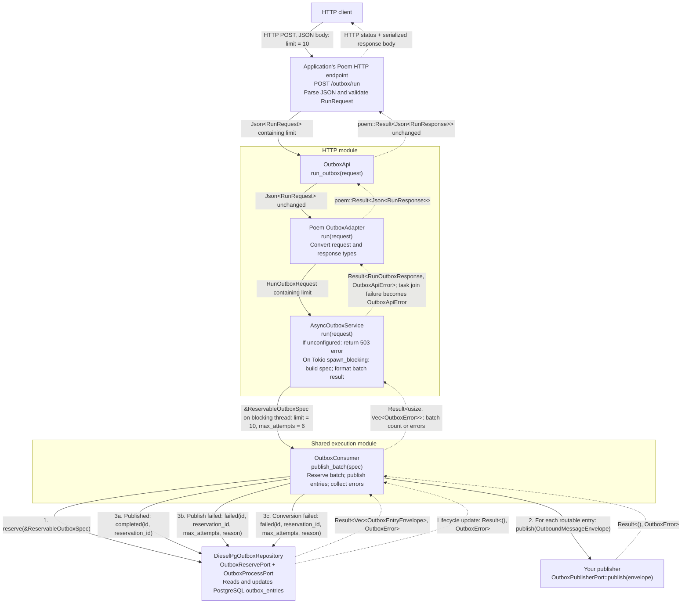

# mulac-outbox

## Module organization

- `src/execution/`: synchronous consumer and reservation specification. HTTP
  triggers and applications both call it.
- `src/http/`: shared HTTP contracts and the blocking-task bridge (`execution.rs`),
  plus Poem and Axum adapters.
- `src/application/`: envelopes, errors, storage and publisher ports, `OutboxRecorder`,
  conversions, and reservation recovery.
- `src/domain/` and `src/infra_diesel/`: lifecycle policy and database implementation.
- `src/amqp_publisher.rs` and `src/confirmed_amqp_publisher.rs`: optional AMQP
  publishers (feature `amqp`).

Import through `mulac_outbox::prelude`. Internal modules are private.

## Item failure isolation

Reservation is one transaction: malformed rows become `Failed`, and healthy
rows are returned without discarding the batch. Each consumer item contains
recoverable panics and attempts `Failed` on processing or completion errors,
then continues. Exhausted entries also stay `Failed`; the attempt cap still
prevents further automatic retries. No automatic path selects `Dead`.

Finalization still requires a working database/repository. Process termination,
abort-mode panics, and hung work require application-owned recovery; sweepers
must still be scheduled. See [the lifecycle and recovery contract](../../docs/item-failure-isolation.md)
for counts, diagnostics, retry timing, limitations, and PostgreSQL test commands.

## Dependency tree

Recording an entry and publishing it are separate steps. The recorder and consumer
must use the same outbox store; they can share one repository through `Arc`.

```text
Record
OutboxRecorder::new(store)
└── Arc<dyn OutboxStorePort>
    └── DieselPgOutboxRepository (or a custom implementation)
        └── DbPool → PostgreSQL outbox_entries table

Publish
OutboxConsumer::new(repository, publisher)
├── Arc<R: OutboxReservePort + OutboxProcessPort>
│   └── Same outbox repository/store as the recorder
└── Arc<dyn OutboxPublisherPort>
    └── AmqpPublisher, ConfirmedAmqpPublisher, or an application-supplied publisher

Reservation recovery (schedule separately)
ReservationSweeper::new(sweep)
└── Arc<dyn OutboxSweepPort>
    └── Same outbox repository/store
```

### Runtime inputs and responsibilities

1. Call `recorder.record(&envelope)`. The recorder validates the routing key and
   sequence, then builds and stores a `NewOutboxEntry`. Success means the entry was
   recorded, not published.
2. Call `consumer.publish_batch(&ReservableOutboxSpec::new(limit))` from an
   application-owned worker or explicit batch trigger. It blocks on storage and the
   publisher. Don't call it from async code, because publishers such as an AMQP
   bridge may block on the application runtime.
3. Call `sweeper.sweep(&StaleReservationSpec::new(timeout))` to recover expired
   reservations. Keep the sweeper and consumer `max_attempts` settings aligned.

`DieselPgOutboxRepository` implements all four storage ports and requires the
`diesel` feature, a database pool, and the outbox schema. Custom repositories can
implement the ports without Diesel. HTTP and Tokio features are not required for
this flow.

Publishing and marking the entry completed are separate calls, not one atomic
transaction, so delivery is at least once.

## Poem: HTTP request through the structs and back

This diagram follows one request. The application mounts `OutboxApi` under `/outbox`
in this example. Solid arrows are calls and dotted arrows are returns. Calls below
the consumer repeat for each reserved entry.



### What changes at each boundary

| Struct               | Receives                | Passes onward                                                                  | Returns to its caller                                                                              |
| -------------------- | ----------------------- | ------------------------------------------------------------------------------ | -------------------------------------------------------------------------------------------------- |
| `OutboxApi`          | `Json<RunRequest>`      | Same request to adapter                                                        | `poem::Result<Json<RunResponse>>`                                                                  |
| Poem `OutboxAdapter` | `Json<RunRequest>`      | Validated `RunOutboxRequest`                                                   | Converts validation error or service result to `Json<RunResponse>` or `poem::Error`                |
| `AsyncOutboxService` | `RunOutboxRequest`      | `ReservableOutboxSpec { limit, max_attempts: 6 }` to consumer on blocking pool | Converts consumer result to `RunOutboxResponse`, or returns a missing-publisher or task-join error |
| `OutboxConsumer`     | `&ReservableOutboxSpec` | Reserved entries to publisher; lifecycle updates to repository                 | `Ok(count)` or `Err(Vec<OutboxError>)`                                                             |

### What reaches the HTTP client

- **Batch succeeds:** HTTP 200 with, for example,
  `{ "processed": 3, "errors": [] }`. The count can be less than the limit.
- **Consumer returns errors:** HTTP 200 with
  `{ "processed": null, "errors": ["<error id>"] }`, one logged ID per failure. Other entries in that batch may
  already have been published; this is not a transaction rollback.
- **Invalid request:** Poem rejects invalid input before the endpoint method, and
  the adapter also validates `limit` (`1..=1000`) when building
  `RunOutboxRequest`. Both map to HTTP 400, including when no publisher is configured. A bad `limit` keeps
  its message, and a body that can't be parsed returns only a logged error ID.
- **No publisher configured:** HTTP 503 with `outbox publisher is not configured`.
  Storage is not touched. Use `OutboxAdapter::unconfigured()` while delivery is off.
- **Blocking task fails to join:** HTTP 500 whose body is a logged error ID.

### Finding an error by ID

Error IDs are logged through `tracing` with the fields `error_id`, `queue` and `error`,
so search your logs for the ID. The host must install a `tracing` subscriber. Failures log
at `error` and unparsable bodies at `warn`. `EnvFilter::from_default_env()` shows only
`error` when `RUST_LOG` is unset, so set `RUST_LOG=warn` to see the IDs for unparsable bodies.

This endpoint publishes entries already recorded in storage; it does not record new
ones. The application constructs and supplies the consumer and its publisher, or
uses `AsyncOutboxService::from_postgres(pool, publisher)`.
