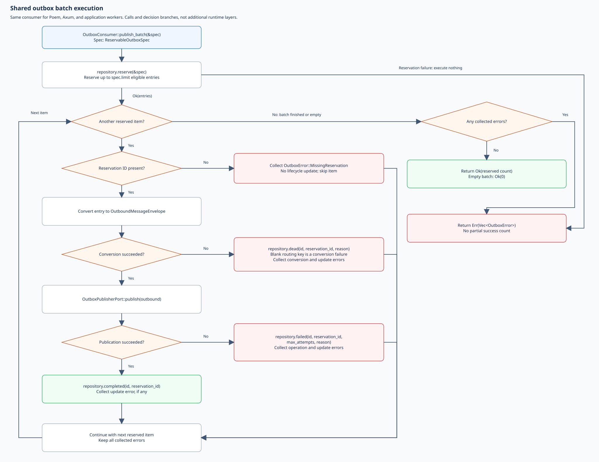
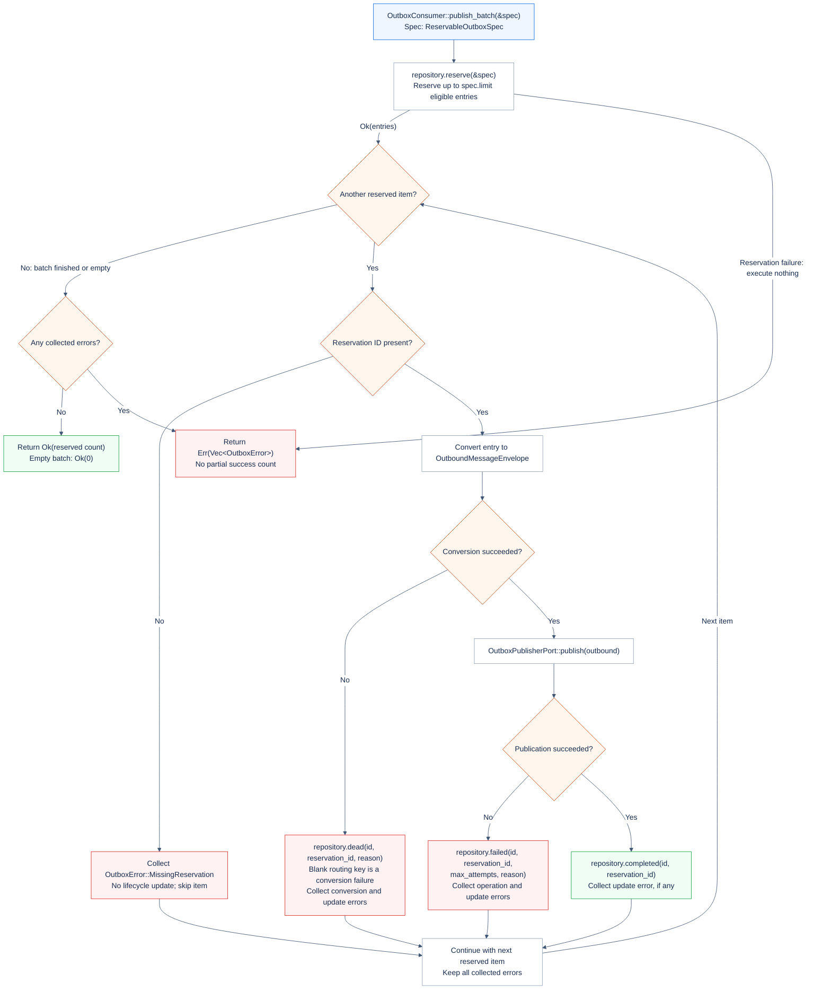
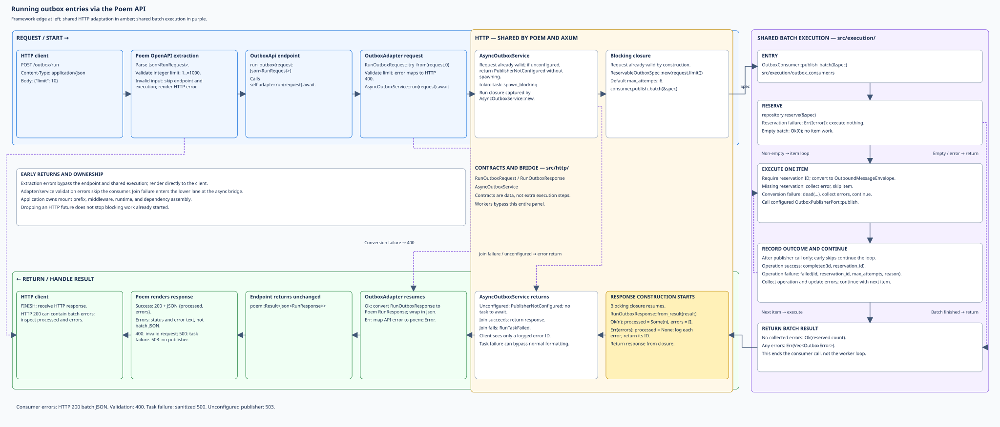
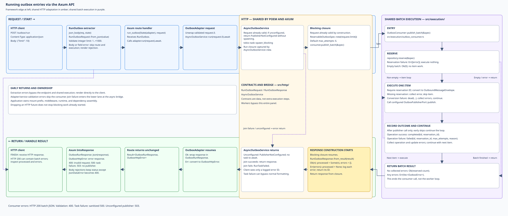
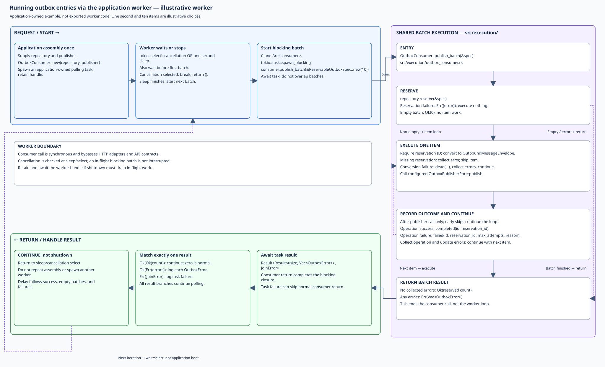
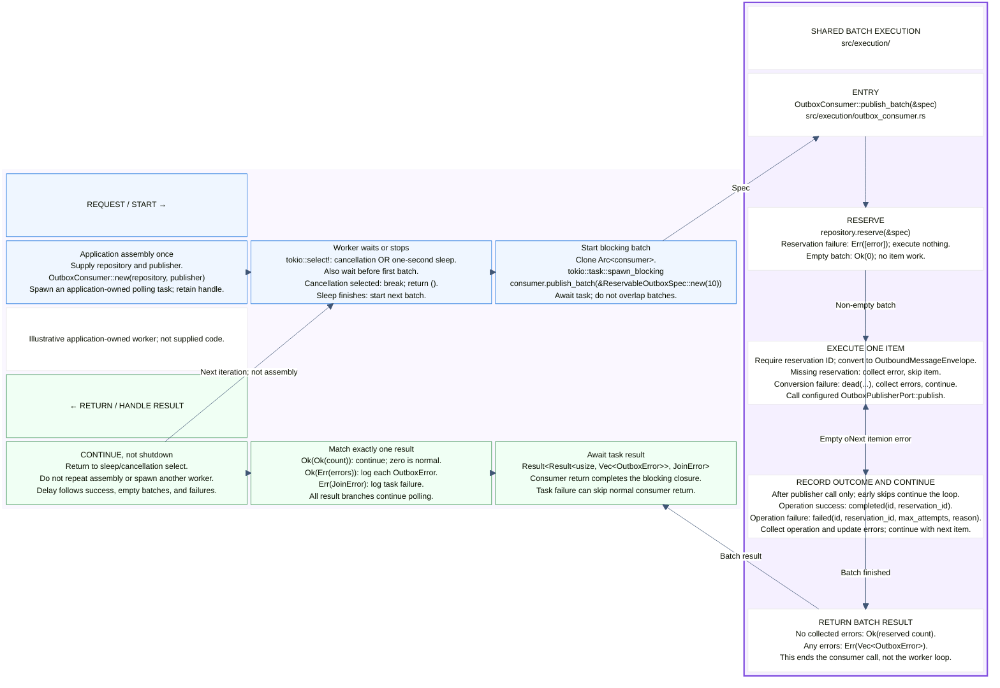

# Outbox batch publication flows

The outbox consumer publishes **already-stored entries** through an
application-supplied `OutboxPublisherPort`. These four views trace the same
batch execution from Poem, Axum, or an application-owned polling worker. Use
them to assemble publication dependencies and distinguish batch failures from
HTTP errors.

Completion means the configured publisher reported success and storage accepted
the completion update. It is not a universal guarantee of broker delivery or
downstream processing: guarantees depend on the publisher. These diagrams stop
at its port rather than expanding AMQP connections, routing, and confirmations.

Recording happens before these flows. Reservation recovery is scheduled
separately; neither the run endpoint nor the illustrated worker starts a
sweeper. Repeated publication remains possible when publishing succeeds but
recording its outcome fails.

## Reading the diagrams

The previews are **hand-arranged SVGs** with native, selectable text. Click an
image for full size. Editable Mermaid follows in an expandable section. Both
representations are maintained separately and must agree on behavior;
Mermaid's automatic layout is not a pixel-exact SVG reproduction. Caller
diagrams require Mermaid `block-beta` support; SVG previews do not.

Read the upper blue request/work lane left to right, enter the purple execution
panel on the right, and return right to left through the lower green lane.
Amber groups HTTP contracts and services shared by Poem and Axum; yellow marks
where normal response construction starts. Workers bypass amber. Arrows show
calls, returns, or labeled alternatives. Dashed SVG paths mark bypasses or loop
continuation. Stacked actions run top to bottom unless labeled as alternatives.

The detailed consumer diagram expands the purple panel. Batch logic and the
reservation spec live in private `src/execution/` files. Shared contracts and
the async blocking bridge live in `src/http/`; framework-specific extraction
and rendering are outside the shared bridge. Application models, conversions,
and ports remain in `src/application/`. There is no intermediate synchronous
`OutboxService` in the current implementation. These are source boundaries,
not additional runtime layers.

## Shared batch execution

[](flow.outbox-consumer.svg)

<details>
<summary>Editable Mermaid source (layout differs from SVG)</summary>



</details>

### Inputs and batch results

`OutboxConsumer::publish_batch(&ReservableOutboxSpec)` reserves entries and
processes them sequentially. `ReservableOutboxSpec::new(limit)` defaults to
`max_attempts = 6`; the spec is input data, not a service.

- Reservation failure returns `Err(vec![error])` immediately, publishing nothing.
- An empty successful reservation returns `Ok(0)`.
- Per-entry publication and lifecycle-update errors are collected; later
  entries are still attempted.
- With no errors, return `Ok(reserved_count)`; otherwise return
  `Err(Vec<OutboxError>)`, not a partial success count. Earlier successful
  publications are not rolled back when the batch returns errors.

With `DieselPgOutboxRepository`, reservation selects due received/failed entries
below the attempt limit. Repository policy controls retry scheduling and
dead-state handling; the consumer does not immediately retry a failed publish
inside its loop. Custom storage implements `OutboxReservePort` and
`OutboxProcessPort`. Align a separately scheduled sweeper's maximum attempts.

### Conversion and publisher outcomes

1. Missing reservation ID yields `OutboxError::MissingReservation`; skip the
   entry without conversion, publication, or lifecycle update.
2. Convert to `OutboundMessageEnvelope`, turning payload into bytes and
   preserving metadata. A whitespace-only routing key fails conversion.
3. Conversion failure calls **`dead(...)` immediately**, collects conversion
   and update errors, and continues. It does not use the publication retry
   branch.
4. Call `OutboxPublisherPort::publish`. Success calls `completed(...)`; failure
   calls `failed(..., max_attempts, reason)`. Collect any lifecycle-update error
   alongside the publication error.

The publisher is replaceable. Do not infer strict broker confirmation from a
generic success arrow: `ConfirmedAmqpPublisher` has stricter routing and
confirmation behavior than `AmqpPublisher`. Publication and lifecycle updates
are separate operations, not one transaction; uncertain delivery or a failed
completion update can lead to delivery again. Downstream processing must
tolerate repeated delivery.

## Running via the Poem API

```mermaid
---
config:
  theme: base
  themeVariables:
    darkMode: false
    background: '#ffffff'
    primaryColor: '#ffffff'
    primaryTextColor: '#172b4d'
    secondaryColor: '#eff6ff'
    tertiaryColor: '#f5f0ff'
    textColor: '#172b4d'
    lineColor: '#405675'
    edgeLabelBackground: '#ffffff'
---
block-beta
    columns 7
    block:caller:4
        columns 4
        request_title["REQUEST / START →"]:4
        request_0["HTTP client<br/>POST /outbox/run<br/>Content-Type: application/json<br/>Body: {&quot;limit&quot;: 10}"]
        request_1["Poem OpenAPI extraction<br/>Parse Json&lt;RunRequest&gt;.<br/>Validate integer limit: 1..=1000.<br/>Invalid input: skip endpoint and execution; render HTTP error."]
        request_2["OutboxApi endpoint<br/>run_outbox(request: Json&lt;RunRequest&gt;)<br/>Calls self.adapter.run(request).await."]
        request_3["OutboxAdapter request<br/>RunOutboxRequest::try_from(request.0)<br/>Validate limit; error maps to HTTP 400.<br/>AsyncOutboxService::run(request).await"]
        edge_note["Extraction errors skip shared execution; alternatives are not sequential steps."]:4
        return_title["← RETURN / HANDLE RESULT"]:4
        response_0["HTTP client<br/>FINISH: receive HTTP response.<br/>HTTP 200 can contain batch errors; inspect processed and errors."]
        response_1["Poem renders response<br/>Success: 200 + JSON {processed, errors}.<br/>Errors: status and error text, not batch JSON.<br/>400: invalid request; 500: task failure. 503: no publisher."]
        response_2["Endpoint returns unchanged<br/>poem::Result&lt;Json&lt;RunResponse&gt;&gt;"]
        response_3["OutboxAdapter resumes<br/>Ok: convert RunOutboxResponse to Poem RunResponse; wrap in Json.<br/>Err: map API error to poem::Error."]
    end
    block:http:2
        columns 2
        http_title["HTTP — SHARED BY POEM AND AXUM<br/>src/http/"]:2
        request_4["AsyncOutboxService<br/>Request already valid; if unconfigured, return PublisherNotConfigured without spawning.<br/>tokio::task::spawn_blocking<br/>Run closure captured by AsyncOutboxService::new."]
        request_5["Blocking closure<br/>Request already valid by construction.<br/>ReservableOutboxSpec::new(request.limit())<br/>Default max_attempts: 6.<br/>consumer.publish_batch(&amp;spec)"]
        contracts["RunOutboxRequest<br/>RunOutboxResponse<br/>Contracts are data; worker bypasses this panel."]:2
        response_4["AsyncOutboxService returns<br/>Unconfigured: PublisherNotConfigured; no task to await.<br/>Join succeeds: return response.<br/>Join fails: RunTaskFailed.<br/>Client sees only a logged error ID.<br/>Task failure can bypass normal formatting."]
        response_5["RESPONSE CONSTRUCTION STARTS<br/>Blocking closure resumes.<br/>RunOutboxResponse::from_result(result)<br/>Ok(n): processed = Some(n), errors = [].<br/>Err(errors): processed = None; log each error; return its ID.<br/>Return response from closure."]
    end
    block:core
        columns 1
        core_title["SHARED BATCH EXECUTION<br/>src/execution/"]
        core_0["ENTRY<br/>OutboxConsumer::publish_batch(&amp;spec)<br/>src/execution/outbox_consumer.rs"]
        space
        core_1["RESERVE<br/>repository.reserve(&amp;spec)<br/>Reservation failure: Err([error]); execute nothing.<br/>Empty batch: Ok(0); no item work."]
        space
        core_2["EXECUTE ONE ITEM<br/>Require reservation ID; convert to OutboundMessageEnvelope.<br/>Missing reservation: collect error, skip item.<br/>Conversion failure: dead(...), collect errors, continue.<br/>Call configured OutboxPublisherPort::publish."]
        space
        core_3["RECORD OUTCOME AND CONTINUE<br/>After publisher call only; early skips continue the loop.<br/>Operation success: completed(id, reservation_id).<br/>Operation failure: failed(id, reservation_id, max_attempts, reason).<br/>Collect operation and update errors; continue with next item."]
        space
        core_4["RETURN BATCH RESULT<br/>No collected errors: Ok(reserved count).<br/>Any errors: Err(Vec&lt;OutboxError&gt;).<br/>This ends the consumer call, not the worker loop."]
    end
    request_0 --> request_1
    response_1 --> response_0
    request_1 --> request_2
    response_2 --> response_1
    request_2 --> request_3
    response_3 --> response_2
    request_3 --> request_4
    response_4 --> response_3
    request_4 --> request_5
    response_5 --> response_4
    request_5 -- "Spec" --> core_0
    core_4 -- "Batch result" --> response_5
    core_0 --> core_1
    core_1 -- "Non-empty batch" --> core_2
    core_1 -- "Empty or reservation error" --> core_4
    core_2 --> core_3
    core_3 -- "Next item" --> core_2
    core_3 -- "Batch finished" --> core_4
    request_1 -- "Extraction error; skip execution" --> response_1
    request_4 -- "Join failure" --> response_4
    request_3 -- "Conversion validation error" --> response_3
    request_4 -- "Unconfigured; no task" --> response_4
    classDef neutral fill:#ffffff,stroke:#94a3b8,color:#172b4d
    classDef request fill:#eff6ff,stroke:#0969da,color:#172b4d
    classDef response fill:#f0fff4,stroke:#1a7f37,color:#172b4d
    classDef highlight fill:#fff1b8,stroke:#bf8700,color:#172b4d
    classDef decision fill:#fff7ed,stroke:#c2410c,color:#172b4d
    classDef success fill:#f0fdf4,stroke:#16a34a,color:#172b4d
    classDef failure fill:#fef2f2,stroke:#dc2626,color:#172b4d
    classDef core fill:#f5f0ff,stroke:#8250df,color:#172b4d
    classDef http fill:#fff8e8,stroke:#bf8700,color:#172b4d
    class request_0,request_1,request_2,request_3,request_title request
    class response_0,response_1,response_2,response_3,return_title response
    style core fill:#f5f0ff,stroke:#8250df,stroke-width:3px,color:#172b4d
    style http fill:#fff8e8,stroke:#bf8700,stroke-width:3px,color:#172b4d
    class response_5 highlight
```

[](flow-poem-api.svg)

<details>
<summary>Editable Mermaid source (layout differs from SVG)</summary>



</details>

### What changes at each boundary

| Boundary                  | Receives and does                                                                   | Returns                                                   |
| ------------------------- | ----------------------------------------------------------------------------------- | --------------------------------------------------------- |
| Poem OpenAPI extraction   | Parse `Json<RunRequest>` and validate integer limit `1..=1000`                      | HTTP error, or invoke endpoint                            |
| `OutboxApi::run_outbox`   | Forward wire request to `OutboxAdapter`                                             | Forward `poem::Result<Json<RunResponse>>`                 |
| `OutboxAdapter::run`      | Validate `RunOutboxRequest::try_from`; await async bridge                           | Convert shared response to Poem wrapper, or map API error |
| `AsyncOutboxService::run` | Accept validated request; require configured consumer closure; use `spawn_blocking` | Batch response, unavailable error, or task-join error     |
| Blocking closure          | Build spec; call `publish_batch`                                                    | Format result with `RunOutboxResponse::from_result`       |

`AsyncOutboxService::new` captures an application-supplied
`Arc<OutboxConsumer<R>>`. The host assembles its repository and publisher;
`AsyncOutboxService::from_postgres(pool, publisher)` is one assembly option.
There is no synchronous service between the bridge and the consumer.

`RunOutboxRequest` is valid by construction: `new`, `from_json`, and
deserialization enforce `1..=1000`, and `limit()` reads the private limit.
Poem's fallible wire conversion checks even manually constructed wrappers.
Validation failure returns 400 before entering the bridge or checking whether
a publisher is configured.

**Normal response construction starts after the consumer returns**, inside the
closure captured by `AsyncOutboxService::new`, on the blocking thread. It builds
`ReservableOutboxSpec::new(request.limit())`, calls `publish_batch`, then formats
with `RunOutboxResponse::from_result`. The bridge returns `Ok(response)` when
the task joins; the adapter converts it into Poem's wire `RunResponse` without
changing its meaning. Publisher and lifecycle-update returns are still batch
execution, not HTTP formatting. Task failure can bypass formatting entirely.

### What reaches the HTTP client

| Outcome                                        | Response                                                          |
| ---------------------------------------------- | ----------------------------------------------------------------- |
| Successful batch                               | HTTP 200: `{"processed":3,"errors":[]}`; count may be below limit |
| Empty batch                                    | HTTP 200: `{"processed":0,"errors":[]}`                           |
| Consumer errors, including reservation failure | HTTP 200: `{"processed":null,"errors":["…"]}`                     |
| Invalid fields or limit outside `1..=1000`     | HTTP 400; no consumer invocation                                  |
| Blocking-task join failure                     | HTTP 500: a logged error ID                                       |
| Valid request, unconfigured publisher          | HTTP 503: `outbox publisher is not configured`                    |

**Unconfigured is not a publication failure.**
`AsyncOutboxService::unconfigured()` returns `PublisherNotConfigured` for any
valid request it receives. Invalid input cannot become a `RunOutboxRequest`:
construction/extraction rejects it first. A valid HTTP request returns 503
without spawning a blocking batch task or touching storage. The
framework adapters also expose an `unconfigured()` constructor.

HTTP errors do not use batch JSON. Body extraction is framework-specific; do
not assume every possible content-type or body-size rejection is HTTP 400.

`/outbox` is an example application-owned prefix; the endpoint declares
`POST /run`. Authentication, authorization, middleware, runtime, and publisher
assembly belong to the host. The bridge starts no worker and creates no
connection. Dropping a disconnected client's HTTP future does not cancel
blocking publication already underway.

## Running via the Axum API

```mermaid
---
config:
  theme: base
  themeVariables:
    darkMode: false
    background: '#ffffff'
    primaryColor: '#ffffff'
    primaryTextColor: '#172b4d'
    secondaryColor: '#eff6ff'
    tertiaryColor: '#f5f0ff'
    textColor: '#172b4d'
    lineColor: '#405675'
    edgeLabelBackground: '#ffffff'
---
block-beta
    columns 7
    block:caller:4
        columns 4
        request_title["REQUEST / START →"]:4
        request_0["HTTP client<br/>POST /outbox/run<br/>Content-Type: application/json<br/>Body: {&quot;limit&quot;: 10}"]
        request_1["RunOutbox extractor<br/>json_body(req, state)<br/>RunOutboxRequest::from_json(value)<br/>Validate integer limit: 1..=1000.<br/>Body or field error: skip route and execution; render rejection."]
        request_2["Axum route handler<br/>run_outbox(State(adapter), request)<br/>Receives RunOutbox.<br/>Calls adapter.run(request).await."]
        request_3["OutboxAdapter request<br/>Unwrap validated request.0.<br/>AsyncOutboxService::run(request.0).await"]
        edge_note["Extraction errors skip shared execution; alternatives are not sequential steps."]:4
        return_title["← RETURN / HANDLE RESULT"]:4
        response_0["HTTP client<br/>FINISH: receive HTTP response.<br/>HTTP 200 can contain batch errors; inspect processed and errors."]
        response_1["Axum IntoResponse<br/>OutboxRunResponse: Json(response).<br/>OutboxHttpError: error response.<br/>400: invalid request; 500: task failure. 503: no publisher.<br/>Body rejections keep status except JsonDataError becomes 400."]
        response_2["Route returns unchanged<br/>Result&lt;OutboxRunResponse, OutboxHttpError&gt;"]
        response_3["OutboxAdapter resumes<br/>Ok: wrap response in OutboxRunResponse.<br/>Err: convert to OutboxHttpError."]
    end
    block:http:2
        columns 2
        http_title["HTTP — SHARED BY POEM AND AXUM<br/>src/http/"]:2
        request_4["AsyncOutboxService<br/>Request already valid; if unconfigured, return PublisherNotConfigured without spawning.<br/>tokio::task::spawn_blocking<br/>Run closure captured by AsyncOutboxService::new."]
        request_5["Blocking closure<br/>Request already valid by construction.<br/>ReservableOutboxSpec::new(request.limit())<br/>Default max_attempts: 6.<br/>consumer.publish_batch(&amp;spec)"]
        contracts["RunOutboxRequest<br/>RunOutboxResponse<br/>Contracts are data; worker bypasses this panel."]:2
        response_4["AsyncOutboxService returns<br/>Unconfigured: PublisherNotConfigured; no task to await.<br/>Join succeeds: return response.<br/>Join fails: RunTaskFailed.<br/>Client sees only a logged error ID.<br/>Task failure can bypass normal formatting."]
        response_5["RESPONSE CONSTRUCTION STARTS<br/>Blocking closure resumes.<br/>RunOutboxResponse::from_result(result)<br/>Ok(n): processed = Some(n), errors = [].<br/>Err(errors): processed = None; log each error; return its ID.<br/>Return response from closure."]
    end
    block:core
        columns 1
        core_title["SHARED BATCH EXECUTION<br/>src/execution/"]
        core_0["ENTRY<br/>OutboxConsumer::publish_batch(&amp;spec)<br/>src/execution/outbox_consumer.rs"]
        space
        core_1["RESERVE<br/>repository.reserve(&amp;spec)<br/>Reservation failure: Err([error]); execute nothing.<br/>Empty batch: Ok(0); no item work."]
        space
        core_2["EXECUTE ONE ITEM<br/>Require reservation ID; convert to OutboundMessageEnvelope.<br/>Missing reservation: collect error, skip item.<br/>Conversion failure: dead(...), collect errors, continue.<br/>Call configured OutboxPublisherPort::publish."]
        space
        core_3["RECORD OUTCOME AND CONTINUE<br/>After publisher call only; early skips continue the loop.<br/>Operation success: completed(id, reservation_id).<br/>Operation failure: failed(id, reservation_id, max_attempts, reason).<br/>Collect operation and update errors; continue with next item."]
        space
        core_4["RETURN BATCH RESULT<br/>No collected errors: Ok(reserved count).<br/>Any errors: Err(Vec&lt;OutboxError&gt;).<br/>This ends the consumer call, not the worker loop."]
    end
    request_0 --> request_1
    response_1 --> response_0
    request_1 --> request_2
    response_2 --> response_1
    request_2 --> request_3
    response_3 --> response_2
    request_3 --> request_4
    response_4 --> response_3
    request_4 --> request_5
    response_5 --> response_4
    request_5 -- "Spec" --> core_0
    core_4 -- "Batch result" --> response_5
    core_0 --> core_1
    core_1 -- "Non-empty batch" --> core_2
    core_1 -- "Empty or reservation error" --> core_4
    core_2 --> core_3
    core_3 -- "Next item" --> core_2
    core_3 -- "Batch finished" --> core_4
    request_1 -- "Extraction error; skip execution" --> response_1
    request_4 -- "Join failure" --> response_4
    request_4 -- "Unconfigured; no task" --> response_4
    classDef neutral fill:#ffffff,stroke:#94a3b8,color:#172b4d
    classDef request fill:#eff6ff,stroke:#0969da,color:#172b4d
    classDef response fill:#f0fff4,stroke:#1a7f37,color:#172b4d
    classDef highlight fill:#fff1b8,stroke:#bf8700,color:#172b4d
    classDef decision fill:#fff7ed,stroke:#c2410c,color:#172b4d
    classDef success fill:#f0fdf4,stroke:#16a34a,color:#172b4d
    classDef failure fill:#fef2f2,stroke:#dc2626,color:#172b4d
    classDef core fill:#f5f0ff,stroke:#8250df,color:#172b4d
    classDef http fill:#fff8e8,stroke:#bf8700,color:#172b4d
    class request_0,request_1,request_2,request_3,request_title request
    class response_0,response_1,response_2,response_3,return_title response
    style core fill:#f5f0ff,stroke:#8250df,stroke-width:3px,color:#172b4d
    style http fill:#fff8e8,stroke:#bf8700,stroke-width:3px,color:#172b4d
    class response_5 highlight
```

[](flow.axum-api.svg)

<details>
<summary>Editable Mermaid source (layout differs from SVG)</summary>



</details>

`RunOutbox` reads JSON through `json_body` and calls
`RunOutboxRequest::from_json` before the `run_outbox` handler. Extraction or
validation errors skip the route, adapter, and consumer. The route forwards
the validated request to `OutboxAdapter::run`, which unwraps `request.0` and
awaits `AsyncOutboxService`.

The shared blocking-closure path is the same as Poem. On return, `OutboxRunResponse`
wraps `RunOutboxResponse` and renders JSON through `IntoResponse`, without
Poem wrapper conversion. The route returns
`Result<OutboxRunResponse, OutboxHttpError>` unchanged.

Consumer errors remain **HTTP 200** with `processed: null`; empty success has
`processed: 0`. Invalid requests map to 400; task-join failure maps to sanitized
500. An unconfigured publisher yields 503 only after validation, without a
batch task or storage access. API errors are plain text, not the batch JSON
shape.

`OutboxHttpError::Body` uses `rejection_response`: `JsonDataError` becomes 400,
while other Axum body-rejection statuses are preserved, including unsupported
content type and configured body-size limits. They render directly, bypassing
execution and normal response construction.

`outbox_routes(service)` installs adapter state and declares relative `/run`.
The host chooses `/outbox` and middleware. This route publishes stored entries;
it does not record new entries. Disconnect behavior is the same as Poem.

## Running via the application worker

[](flow.outbox-worker.svg)

<details>
<summary>Editable Mermaid source (layout differs from SVG)</summary>



</details>

This is an **illustrative application-owned polling pattern**, not supplied
library worker code or a new exported API. Its one-second delay and ten-entry
batch are documentation choices matching the kernel event-worker pattern, not
outbox scheduling defaults.

Assemble the repository and publisher once, construct `OutboxConsumer`, wrap
it in an `Arc`, and spawn a polling task on the application runtime. Retain the
task handle. The following is pseudocode, not an existing function:

```text
application boot: assemble consumer; spawn polling task; retain handle
loop:
    select cancellation OR sleep(one second)
    if cancellation selected: break and return ()
    clone consumer
    await spawn_blocking:
        consumer.publish_batch(&ReservableOutboxSpec::new(10))
    match task result:
        Ok(Ok(count)): continue normally, including count == 0
        Ok(Err(errors)): log each OutboxError
        Err(join_error): log task failure
    continue at sleep/select, not at application assembly
shutdown: cancel token; await retained task handle to drain
```

The publisher owns connection behavior. Runtime-bound publishers such as
`ConfirmedAmqpPublisher` require a current application Tokio runtime and must
run on its blocking pool. This pattern supplies that context; the worker does
not itself open broker connections. The crate exports no built-in outbox
polling worker.

The loop bypasses HTTP adapters, API services, request validation, and response
formatting. It receives `Result<usize, Vec<OutboxError>>` inside the task's join
result, not `RunOutboxResponse`. The spec's default attempt limit is six; the
HTTP `1..=1000` range is not validation in its constructor.

One blocking job is awaited per iteration, so this worker does not overlap its
own batches. It sleeps before its first batch and after all outcomes; this is
a delay, not a fixed-rate schedule. Sleeping does not override retry
eligibility. Cancellation is checked at sleep/select and does not interrupt an
in-flight batch. Cancel and await the retained handle when shutdown must drain.

## Source references and maintenance

- [Consumer](src/execution/outbox_consumer.rs), [reservation spec](src/execution/reservable.rs), and [conversion](src/application/conversions.rs)
- [Message models](src/application/models.rs) and [publisher/storage ports](src/application/ports.rs)
- [HTTP contracts](src/http/contract.rs) and [async execution bridge](src/http/execution.rs)
- [Poem endpoint](src/http/poem/routes.rs) and [adapter](src/http/poem/adapter.rs)
- [Axum routes](src/http/axum/routes.rs) and [extractor/adapter](src/http/axum/adapter.rs)
- [Confirmed publisher](src/confirmed_amqp_publisher.rs) and [configurable AMQP publisher](src/amqp_publisher.rs)
- [Diesel repository](src/infra_diesel/repository.rs) and [separately scheduled recovery](src/application/stale_reservation_sweep.rs)
- [Public prelude](src/lib.rs) and [feature flags](Cargo.toml)
- [Poem HTTP tests](../../test_apps/http_adapters/tests/outbox_poem.rs) and [Axum HTTP tests](../../test_apps/http_adapters/tests/outbox_axum.rs)
- [Shared body rejection handling](../mulac_http/src/body.rs) and [Poem wire contracts](../mulac_http/src/poem.rs)

External callers use `mulac_outbox::prelude` and its `poem`/`axum` re-exports.
Linked private files explain implementation, not supported import paths.
HTTP adapters enable the Tokio bridge; the consumer itself does not require
HTTP. The `api` feature exposes contracts; `api-tokio` adds the bridge. A
publisher can impose its own runtime requirements. Diesel and AMQP
dependencies are independently feature-gated as declared in the manifest.

When behavior changes:

1. Recheck implementation and tests, then update prose, Mermaid, and SVG
   together. Keep each caller's shared panel consistent with the detailed flow.
2. Render all four Mermaid blocks with a `block-beta`-capable renderer. Keep
   extracted `.mmd` files and automatic previews in ignored scratch space;
   never replace the hand-arranged SVGs with automatic exports.
3. Parse SVGs as XML and verify titles, descriptions, links, and full-size
   readability. Check text bounds and arrow routing; preserve native text and
   no external assets.
4. Review success, empty/reservation-failure batches, missing reservations,
   conversion-to-dead and publication/update errors, unconfigured publisher,
   HTTP validation/task errors, and worker cancellation. Run library and HTTP
   adapter tests.

Recording, transport internals, and recovery remain outside these four views;
do not silently add them to the batch path.
